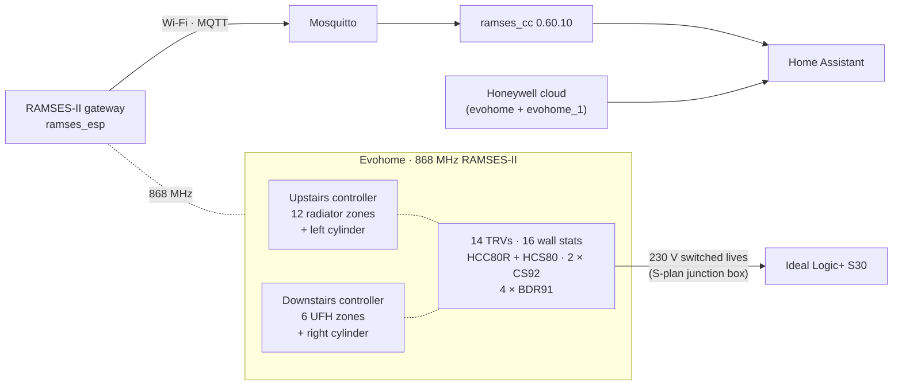

# Evohome Heating Controls: Install, Home Assistant Integration (Cloud → RAMSES-II) and a Live Fault Case Study

**A two-controller Honeywell Evohome system covering 18 zones (12 radiator and 6 underfloor) and two unvented DHW cylinders. Self-designed and installed in 2018; brought into Home Assistant in 2026, first through Honeywell's cloud and then locally over the 868 MHz RAMSES-II radio; and, along the way, the subject of a live fault that locked every zone on both controllers to 5 °C.**

[](https://www.youtube.com/channel/UC5Cupmz7vlfcodpCX7k8iuQ)
[](https://github.com/the-control-cabinet)


> **The short version**
> - **2018, install:** I designed and installed Evohome myself:
>   - two controllers, radiators and underfloor
>   - 14 TRVs and 16 wall stats
>   - an HCC80R underfloor controller
>   - two DHW kits
>   - four BDR91 relays wired into the existing S-plan junction box, with the boiler untouched
> - **August 2026, cloud:** brought into Home Assistant through **Honeywell's cloud**, with a custom-component workaround so both controllers appeared.
> - **The cloud's limits** (polling, rate limits, no device-level data) led me to the 868 MHz radio and a **RAMSES-II gateway**.
> - **The fault:** the day after the gateway's first set-up, **every zone on both controllers locked to 5 °C**. Eight hypotheses, each tested at the next schedule switchpoint, and an icon comparison led to a zone-by-zone rebuild that fixed it. A **packet-log audit** then showed the gateway never sent the offending command.
> - **Rebuilt integration:** the released MQTT mode, a hand-written system schema, an upgrade to fix an underfloor bug, and **transmit enabled only after the audit**.
> - **October 2026, site survey:** after a Resideo controls wiring course, I isolated the plant and traced the junction box terminal by terminal. It corrected the design record (the UFH relay still drives its zone valve; the hot-water timer still gates both cylinders), **closed the cylinder cut-out safety check**, found a **missing automatic bypass**, and produced an as-built vs Evohome map with a reversal procedure.
> - **Still open:** the gateway's connectivity when it isn't on a PC's USB port; the bypass (Gas Safe fix).

> **Device IDs are masked.** Real RAMSES-II addresses are replaced with consistent placeholders that keep the device-type prefix (`01:000001` = controller 1, `04:…` = TRV, `34:…` = wall stat, `13:…` = BDR91, `18:000001` = the gateway). Every file uses the same mapping.

**Portfolio position:** Stage 2.5 (heating system instrumentation and protocol integration) and #10 (fault diagnosis case study) · Field and Automation levels.

---

## Contents

1. [The system at a glance](#1-the-system-at-a-glance)
2. [Part A · Design and installation (2018)](#2-part-a--design-and-installation-2018)
3. [Part B · Home Assistant integration (2026)](#3-part-b--home-assistant-integration-2026)
4. [Part C · Fault case study: the permanent 5 °C override](#4-part-c--fault-case-study-the-permanent-5-c-override)
5. [Operating rules](#5-operating-rules)
6. [Results](#6-results)
7. [Roadmap and open items](#7-roadmap-and-open-items)
8. [Skills demonstrated](#8-skills-demonstrated-bms--building-automation)
9. [Detailed documents and repository map](#9-detailed-documents-and-repository-map)

---

## 1. The system at a glance



| Item | Detail |
|---|---|
| House | Built around 2017, three storeys |
| Boiler | Ideal Logic+ S30 system boiler, S-plan (230 V switched-live control) |
| Controllers | 2: radiators (12 zones) and underfloor (6 zones) |
| Field devices | 14 × HR92 TRVs, 16 × T87RF wall stats, HCC80R + HCS80 UFH controller, 2 × CS92 cylinder sensors, 4 × BDR91 relays: **40 RF devices** in all ([inventory](data/device-inventory.csv)) |
| Hot water | 2 × Centre Store 250 L unvented indirect cylinders, one per controller |
| Boiler-demand paths | 4 BDR91 switched lives → 1 boiler switched-live input |
| HA integrations | Cloud `evohome` + `evohome_1` (Aug 2026); `ramses_cc` via a ramses_esp gateway (Sep 2026) |

---

## 2. Part A · Design and installation (2018)

### 2.1 Architecture: two controllers, one boiler

The house is split into two independent Evohome systems, each with its own zones, boiler call and cylinder:

| | Upstairs controller | Downstairs controller |
|---|---|---|
| Heats | Radiators, 12 zones | Underfloor, 6 zones |
| Zone actuators | HR92 TRV on every radiator (two zones have two) | HCC80R + HCS80, driving the manifold actuators and UFH pump |
| Room sensors | T87RF wall stats (one zone uses its TRV's sensor) | T87RF wall stats (Kitchen uses the controller's sensor) |
| Boiler call | BDR91 | BDR91 |
| Hot water | Left cylinder: CS92 + BDR91 on its zone valve | Right cylinder: CS92 + BDR91 on its zone valve |

### 2.2 Key design decisions

| Decision | Reasoning |
|---|---|
| **TRVs and the HCC80R do the zoning; the S-plan valves stay** | On the radiator circuits the TF and MF zone-valve heads are **fitted but disconnected, manual override latched**, each HR92 controls its own radiator, and the radiator BDR91 calls the boiler **directly**. The UFH BDR91 **still drives the UF zone valve**, which fires the boiler through its end switch (corrected by the [Oct 2026 survey](docs/A4-junction-box-survey-and-wiring.md)) |
| **Wall stats as remote sensors** | Room temperature measured at a sensible height, away from the radiator, while the controller still drives the TRV or actuator |
| **Boiler untouched** | All four BDR91s were wired into the installer's existing external junction box. All four demands reach the boiler's single switched-live input: the radiator relay directly, the UFH and cylinder relays via their valves' end switches. The hot-water relays switch the **Danfoss TS715Si's output**, so the timer (permanent ON) still gates hot water |
| **Two systems, not one** | Room for 18 zones and two DHW circuits. The cost is two RF systems to maintain, and one OpenTherm master per boiler, so Evohome's OpenTherm bridge can't serve both (see [roadmap](#7-roadmap-and-open-items)) |

**Underfloor hydraulics:** mixing (blending) valve → pump → flow manifold with flow meters → loops → return manifold. The HCC80R zone order is Lounge, Family Room, Kitchen, Dining, Hall, Utility.

### 2.3 Hot-water cylinders and where the sensor went

Each Centre Store 250 L cylinder has two front boxes: one at about **¼ height** (immersion element and thermostat pocket) and one at about **⅗ height** (a circular opening onto the cylinder shell, **no pocket** and no electrics). The lower box holds **two pockets**, and the Evohome **CS92 probe went into its top pocket**.

**Why: stratification.** The coil is at the bottom. Heated water rises, so hot water collects at the **top first** and the hot layer grows **downwards** as the reheat goes on. The region just above the coil is the last to reach temperature.

| Probe position | Reads "at setpoint" | Result | Side effect |
|---|---|---|---|
| **Lower (¼)** ✅ | **Last**, once the hot layer reaches it | The controller stops only when **most of the cylinder** is hot, giving full usable volume | The **top can overshoot** the setpoint while the lower part catches up. Keep the setpoint sensible (about 55-60 °C); the high-limit cut-out is the backstop |
| Upper (⅗) | **Early**, because the top heats first | Stops with the **lower part still cool**, giving less hot water | n/a |

> ✅ **Safety check closed (29 Oct 2026):** on both cylinders the **boiler-control module** (adjustable stat + manual-reset overheat cut-out) is fitted and wired **in series with the zone valve motor**, so a trip closes the valve whatever Evohome does ([A4](docs/A4-junction-box-survey-and-wiring.md#5-cylinder-wiring-panels)).
>
> The lower box is the **immersion element head**: the CS92 sits in its **top pocket** (where the immersion's Cotherm element control went; both Cotherms have been out since 2018, so the immersions are disconnected), and the cut-out probes are in the **bottom pocket**. Using the immersion as a backup means swapping the Cotherm back in: [A7](docs/A7-immersion-backup-swap-procedure.md).

### 2.4 Commissioning and binding

Order of work: relays at the junction box (isolated, tested dead) → controllers and zones → each zone's actuators and sensor → system devices (BDR91s, CS92s) → schedules and cloud link → verify each zone calls for heat at a switchpoint and DHW stops at setpoint.

| Device | How it binds | Trap |
|---|---|---|
| HR92 TRV | Controller "bind actuator" for the zone, then bind on the TRV | Zones with two TRVs need both bound |
| T87RF wall stat | Bind from its **touch zones** (no button), then set as the zone's **remote sensor** | Without "remote sensor", the controller keeps using the TRV's reading |
| BDR91 | From the controller's system or DHW menu, then the BDR91's bind button | The DHW kit's BDR91 belongs to the DHW function, not heating |
| CS92 | From the controller's DHW set-up | n/a |
| **HCC80R zone** | Transmit button: all LEDs yellow, then each press selects the next zone (LED **flashes green**). Then "bind actuator" on the controller | The controller says **"success" before the HCC80R accepts**. The real confirmation is the zone LED going **solid amber** |

All zones have **local override** enabled: a wall-stat change holds until the next switchpoint and shows a **clock** icon with **Cancel**. That detail became the key to Part C.

### 2.5 Known plant issues (under investigation)

| Issue | Current understanding | Next step |
|---|---|---|
| Tundishes drip when hot water is used | Likely failed DHW expansion vessels and/or relief valves | Plumber to replace both; inlet pressure gauges and tundish drip sensors to confirm |
| Slow loss of heating-system pressure | Not the boiler's expansion vessel (recharged, and its diaphragm isn't leaking) | Trend the new boiler pressure gauge; isolate circuits one at a time |
| Missing pipe lagging | Avoidable primary and DHW losses | Complete it |
| **No automatic bypass** | The Ideal Logic+ System S30 manual requires an ABV with TRVs on all radiators or two-port valves; there are HR92s everywhere, five two-port valves, and no ABV found ([A6](docs/A6-pump-overrun-and-bypass.md)) | Read the boiler fault history for L1 lockouts; Gas Safe engineer to fit an ABV or leave one radiator (≥ 0.6 kW) open |
| TF/MF valves latched in manual override | May not be fully open, restricting the radiator circuits | Check the position; re-power the heads on a permanent live if needed |
| **Boiler earth** | The boiler's supply flex has no earth core | Prove the earth path (continuity to the earth bar); Gas Safe to fit a flex with a CPC |
| Slow pressure leak | Topped up about every two weeks; fault history shows F1 twice | Gas Safe: relief valve, expansion vessel, leak search, inhibitor |
| Wiring identification | Blues used as switched lives, greys and a black used as neutrals; two floating Danfoss cores; hot-water BDR91s on stiff cable, loose | Tidy-up planned: sleeving, caps, labels, flex in trunking ([A4](docs/A4-junction-box-survey-and-wiring.md#7-planned-tidy-up-box-still-isolated)) |

---

## 3. Part B · Home Assistant integration (2026)

### 3.1 Step 1: Honeywell cloud integration (August 2026)

HA's core **`evohome`** integration uses Honeywell's Total Connect Comfort API. It's configured in **YAML only**, with credentials in `secrets.yaml`.

```yaml
evohome:
  username: !secret evohome_username
  password: !secret evohome_password
```

**Challenge: only one controller appeared.** The integration connects to one location or controller per configuration. **Workaround:** the core integration was copied in as a custom component with its own domain, **`evohome_1`**, configured for the second controller. Both systems then showed in HA. The trade-off is that the copy must be refreshed by hand after HA upgrades.

A "Total Connect Comfort" entry marked "not set up via the UI" turned out to be this same YAML integration, not a rogue one. That mattered when every integration had to be ruled out in Part C.

| Cloud limitation | Effect |
|---|---|
| Internet / Honeywell dependency | No data or control in an outage |
| Polling | Changes appear minutes late |
| Rate limits | HTTP **429** under load (hit when trying a bulk schedule export) |
| No device-level data | No TRV demand, BDR91 states, UFH circuits or battery/signal |

### 3.2 Step 2: looking at the radio (late August 2026)

An **RTL-SDR** receiver running `rtl_433` showed Evohome transmitting constantly at around **868.1 MHz**. But `rtl_433`'s Honeywell decoders don't cover RAMSES-II, so the traffic could be seen but not decoded. Conclusion: the data is there locally, and a purpose-built **RAMSES-II gateway** is needed.

### 3.3 Step 3: the RAMSES-II gateway (September 2026)

| Item | Detail |
|---|---|
| Gateway | Indalo Tech **ramses_esp**: ESP32-S3 + CC1101 868 MHz radio, connected over **Wi-Fi → MQTT** |
| Set-up | USB serial console: **115200 8N1, local echo on, CR+LF**; commands such as `wifi ssid …`, `wifi password …`, then MQTT broker details |
| Gotchas | PuTTY couldn't open the port (Tera Term could); no prompt appears because the stick prints live RF packets (e.g. `I --- 04:… --:------ 01:… 3150 002 0000`, a TRV reporting heat demand). That was the first proof the radio worked |
| MQTT topics | `RAMSES/GATEWAY/<id>/rx`, `/tx`, `/info/version` on the Mosquitto add-on |
| HA integration | **ramses_cc** (HACS). First set up via the **in-development "HA MQTT broker" option** (see Part C), later moved to the released **standalone MQTT broker** mode (`port_name: mqtt://…`) |
| Errors met | "expected a mapping", "not a valid option": wrong mode or serial-field format |

### 3.4 The system schema: a points schedule built from packets

Discovery alone gave a flat, partial device list, because ramses_cc can't always tell which zone a device belongs to. The fix was a **system schema** built by listening with Tx off: grouping devices by the controller they talk to, mapping devices to zones from zone-indexed packets, cross-checking with the app and the HCC80R's physical zone order, and identifying the BDR91s by role.

```yaml
'01:000002':                       # downstairs controller (masked ID)
  _class: CTL
  stored_hotwater: {sensor: '07:000002', hotwater_valve: '13:000003', heating_valve: null}
  system: {appliance_control: '13:000004'}
  underfloor_heating:
    '02:000001':                   # HCC80R
      circuits: {'00': {zone_idx: '00'}, '01': {zone_idx: '01'}, …}
  zones:
    '00': {_name: Lounge, class: underfloor_heating, sensor: '34:000012'}
    …
```

| Rule learned | Detail |
|---|---|
| Names must match exactly | Including the controller's own spelling: one zone name had a typo that the schema had to copy |
| Assumptions accepted | Kitchen's sensor is the controller itself; HCC80R circuits map one-to-one to zones |
| Phantom device | A spurious gateway ID had been learned; it was deleted and doesn't return |
| After loading | Restart, check each zone once, no errors, HCC80R discovered, then enable "accept known devices only" |

Full schema: [config/ramses-schema.yaml](config/ramses-schema.yaml) (zone names anonymised).

### 3.5 Home Assistant: two integrations side by side

| | Cloud `evohome` / `evohome_1` | `ramses_cc` |
|---|---|---|
| Path | Internet → Honeywell → controllers | Local 868 MHz radio |
| Used for | **System mode** (the controllers never answer or broadcast `2E04`, so ramses_cc shows it as null) | Device-level data, fast updates, controlled writes |
| Entity names | `climate.<zone>` | `climate.rf_<zone>` |

Both integrations wanted the same IDs, so ramses_cc's copies came out as `climate.hall_2` and so on. A [registry script](scripts/rename_rf_entities.py), run with HA stopped and a backup taken, renamed them to `rf_*`. Zones and UFH circuits appear as child devices of their controller; TRVs, wall stats and BDRs stay top-level, which is ramses_cc's design and only cosmetic.

**Upgrade 0.60.4 → 0.60.10:** the underfloor zones showed **no heat demand**. It looked like a binding problem, but it was a known ramses_cc defect (#1154), fixed in 0.60.10. Lesson: check the vendor's issue tracker before re-engineering your own configuration.

### 3.6 Read-only first, then an audited transmit

Tx stayed **off** until the gateway's entire transmit history had been audited:

```bash
# everything the gateway sent that isn't a read request
awk '$5=="18:000001" && $3!="RQ"' /config/ramses_rf_logs/packet_log.log
# all its traffic by verb and code
awk '$5=="18:000001"{print $3,$8}' /config/ramses_rf_logs/packet_log* | sort | uniq -c | sort -rn
```

| Finding | Result |
|---|---|
| Packet types ever sent | **RQ** reads and **W 2349** zone-mode writes only |
| Writes | 20, all temporary setpoints (mode `01`) on single upstairs zones |
| 5 °C (`01F4`) or permanent mode (`02`) | **None** |
| Writes to the downstairs controller | **None** |

Tx was then enabled deliberately (`disable_sending: false`, raw `send_packet` service still off). **Control test passed:** a temporary 13 °C on the Hall zone from HA, then cancelled. The first awk command is re-run after any change; empty output, or only deliberate writes, is a pass.

### 3.7 Open issue: gateway connectivity

| Observation | Meaning |
|---|---|
| While "offline" it **still answered ping** and its serial console | Wi-Fi up; points at the MQTT session not being restored |
| Eight other ESP32s on the same network stayed connected | Not a general network problem |
| **Stable on a PC or laptop USB port** (16 h+ and 12.5 h+ runs with the laptop awake) | Earlier gaps were the laptop sleeping |
| **Unreliable on a wall adapter** | Either the **supply** (ESP32-S3 Wi-Fi current peaks, a sagging or noisy 5 V) or **Wi-Fi coverage** where the adapter is |

Current workaround: powered from the PC, which isn't a central position. Next steps:
1. Wall adapter **at the PC's location**, which changes only the supply.
2. A known-good 5 V 2 A+ supply and a short, thick cable.
3. Better 2.4 GHz coverage at the central spot.

Packets per hour (`cut -c1-13 | sort | uniq -c` on the logs) show any gap exactly. The issue has been raised on the firmware's public repository; no response yet.

---

## 4. Part C · Fault case study: the permanent 5 °C override

### 4.1 Symptom and impact

| Symptom | Detail |
|---|---|
| Setpoint | **Every zone on both controllers at 5 °C** |
| Display | "Override", with a **sun-and-thermometer** icon and **no Cancel** |
| Schedules and system mode | Correct, never 5 °C; system not in Away or frost |
| Persistence | Manual changes held only until the **next switchpoint**, then back to 5 °C. A power cycle helped only until the next switchpoint |

**Impact:**
- **The house went cold.** With every zone at 5 °C, no zone called for heat.
- **Daily workaround:** for about two weeks, every zone was overridden by hand each evening.

### 4.2 Timeline

| When | Event |
|---|---|
| 18 Sep | Gateway set up; ramses_cc via the **in-development HA MQTT bridge** |
| 18 Sep 23:48 | Gateway's first write: one upstairs zone 21.50 °C, temporary |
| 19 Sep 11:12 | Downstairs controller's own broadcast shows zone 00 at **5.00 °C** (others 12 °C), hours before anyone noticed. The gateway had **never written to that controller** |
| 19 Sep 17:28 | All zones, both controllers, at 5 °C. Gateway unplugged at 17:32 |
| 21 Sep | Still faulty 24 h later with the gateway unplugged and ramses_cc disabled |
| 25 Sep | Cloud integration checked: nothing rogue |
| 2 Oct | Cloud integration and ramses_cc removed entirely: no change. **Icon comparison** carried out |
| 3 Oct | One zone deleted, re-added and re-bound: it recovers |
| Early Oct | Both controllers rebuilt zone by zone, so the fault is cleared |
| 9 Oct | Gateway back on the released MQTT mode, Tx off: no recurrence. Packet audit done |

### 4.3 Hypotheses, each tested at the next switchpoint

| # | Hypothesis | Test | Verdict |
|---|---|---|---|
| H1 | System mode (Away, frost, Off) | Checked both controllers | ❌ Normal mode |
| H2 | Corrupted schedules | Inspected every zone | ❌ Correct, no 5 °C |
| H3 | Gateway actively sending | Unplugged for 24 h+ through switchpoints | ❌ Fault persisted |
| H4 | HA integration or automation | No heating automations; both integrations removed | ❌ Fault persisted |
| H5 | Cloud pushing commands | Fault only ever at each zone's own switchpoint, which is controller-local timing | ❌ Unlikely |
| H6 | An ordinary wall-stat override | Compared with a deliberate one (below) | ❌ Different mechanism |
| H7 | **Corrupted stored zone state or bindings** | Delete, re-add and re-bind one zone | ✅ **Recovered** |
| H8 | Corruption in the TRVs or wall stats | Rebuilt zones re-bound to the **same** devices | ❌ Devices fine |

### 4.4 The decisive observation

| | Deliberate wall-stat override | Faulted zones |
|---|---|---|
| Label | Override | Override |
| Icon | **Clock** | **Sun and thermometer** |
| Cancel | **Yes** | **No** |
| Value | Whatever was set | Always 5 °C |
| Behaviour | Clears at the next switchpoint | Re-applied at every switchpoint |

Same word, different mechanism. This moved the investigation from "who is sending commands?" to "what has the controller stored for these zones?".

### 4.5 Fix

Per zone, on each controller: **record** the settings → **delete** the zone → **re-add** it (same name) → **re-bind** the TRV(s) or HCC80R actuator → **re-bind** the T87RF as remote sensor → **re-enter** the schedule → **verify** at the next switchpoint. Watch for the HCC80R trap: trust the zone LED going solid amber, not the controller's "success". **No factory reset, no hardware replaced.**

### 4.6 Root cause: proven vs unproven

- **Proven:** the fault lived in the controllers' stored zone configuration or bindings, because the rebuild cleared it with the same hardware.
- **The suspect audited:** the gateway's log contains **no** 5 °C write, **no** permanent override and **no** write at all to the downstairs controller, which faulted anyway.
- **Working theory (unproven):** stored state was disturbed while the system was first probed through the in-development integration path, perhaps by malformed or repeated traffic during gateway Wi-Fi drop-outs.
- **Verdict:** fix proven; gateway cleared as a direct sender; root cause not proven, and stated as such.

Decoding the downstairs controller's own broadcast, which showed 5 °C before the fault was noticed:

```
I --- 01:000002 --:------ 01:000002 2309 018 00 01F4 01 04B0 02 04B0 03 04B0 04 04B0 05 04B0
                                       zone 00 = 0x01F4 = 500 → 5.00 °C; zones 01-05 = 0x04B0 → 12.00 °C
```

### 4.7 Lessons

1. **Read the evidence the system gives you.** One word ("Override") hid two mechanisms. On a BMS head-end, an operator override, a priority-array write and a controller fallback can all look like "manual".
2. **Test at the trigger event.** Here that was the next switchpoint, just as schedules and optimum start are verified at the transition.
3. **Audit before you accuse.** The newest device was the obvious suspect; its own log cleared it.
4. **Least-invasive fix first:** one zone, then all zones; never a factory reset.
5. **Trust the field device's acknowledgement,** not the head-end's.
6. **Change control on live plant:** released software, read-only commissioning, logged writes.

---

## 5. Operating rules

| Rule | Why |
|---|---|
| Only released integration modes on the live system | Lesson from Part C |
| Never use HVAC *off*, *Heating Off* or *Day Off* presets from HA | System-wide writes to live plant |
| Don't use ramses_cc's `get_zone_schedule` | Known issue (#1241): a timeout can silently stop Tx until a full restart |
| Restart rather than reload ramses_cc | Known issue (#1242): a reload can show the wrong hub mode |
| Re-run the Tx audit after any change | Every write attributable |
| Watch for the sun-and-thermometer icon or any zone at 5 °C | Early detection |

## 6. Results

| Measure | Result |
|---|---|
| Zones modelled in HA | 18 / 18, with the correct actuators and sensors |
| Heat demand | All zones, including UFH after the 0.60.10 upgrade |
| Gateway transmissions | Only reads and deliberate temporary setpoints; nothing system-wide |
| Control from HA | Hall zone temporary 13 °C set and cancelled: passed |
| 5 °C fault | Fixed on both controllers; no recurrence on the released MQTT mode |
| Gateway connectivity | Stable on a PC's USB port; unreliable on a wall adapter (open) |

---

## 7. Roadmap and open items

### Safety (first)
- [x] ✅ **Both cylinders' high-limit cut-outs verified** fitted, sensing and wired in series with the zone valves (29 Oct 2026).
- [ ] ⚠️ **Automatic bypass:** read the boiler fault history (L1), search the pipework, check the Benchmark sheet; Gas Safe engineer to fit an ABV or an open radiator ([A6](docs/A6-pump-overrun-and-bypass.md)).
- [ ] On every re-energisation: **TS715Si on permanent ON** (it gates hot water), BDR91s reporting, heating and hot water both run.

### Junction box tidy-up (box isolated)
- [ ] Re-run the hot-water BDR91s in 3095Y 5-core flex via 25×16 trunking onto surface pattresses.
- [ ] Wago 221 on the four opto-tapped joints; cap the Danfoss black and grey; sleeve misused colours; label every cable, strip position and the lid.
- [ ] Wire the opto board in its own enclosure (plant monitoring repo).
- [ ] Add heat-transfer paste to both CS92s.

### Gateway
- [ ] Separate supply from Wi-Fi location (above), then move the gateway to a central position; update the issue on the firmware repository.
- [ ] Keep the September packet logs permanently; confirm the upstairs boiler-demand BDR91 appears in captures.

### Plant room: physical works (soon)
| Item | Purpose |
|---|---|
| Replace both DHW **expansion vessels** and **relief valves** (plumber) | Cure the tundish drips |
| **Pressure gauges on both cylinder cold inlets** (0-150 PSI) | Track working pressure and any rise towards the relief setting: a second diagnosis alongside the drip sensors |
| **Tundish drip sensors** | Detect discharge as it happens |
| **Complete the missing lagging** | Cut avoidable losses |
| **Trace the slow system pressure loss** with the new boiler gauge | Boiler's expansion vessel ruled out; isolate circuits one at a time |

### Plant room: monitoring (soon)
| Item | Purpose |
|---|---|
| **CT clamp on the boiler switched live / supply** | Boiler states (standby, pump, firing, DHW) into HA |
| **Opto boards on all four BDR91 switched lives** and the boiler's | Exactly which controller and function is calling, which is also an input to the OpenTherm logic |
| **Strap-on NTCs on both DHW cylinder hot outlets** | Real top-of-cylinder temperature vs the CS92; quantify the top overshoot; weekly 60 °C check |
| Flow/return temperatures, pressures, leak plates | Full boiler and primary picture |

The monitoring build is documented in its own repository: [heating-plant-monitoring-esphome](https://github.com/the-control-cabinet/heating-plant-monitoring-esphome).

### Supervisory and boiler control (planned, in their own repos)
Evohome stays the **zone controller** throughout; its RAMSES-II data and BDR91 states become inputs to:

| Step | Project | Evohome's part |
|---|---|---|
| B | [HA + Node-RED supervisory layer](https://github.com/the-control-cabinet/ha-node-red-supervisory-layer) | Its RAMSES-II entities are read; temporary setpoints are the only writes, under tiered command authority |
| C | [Optimum start/stop](https://github.com/the-control-cabinet/optimum-start-stop-supervisory) | Executes **temporary setpoints** sent over RAMSES-II; built-in optimisation switched off |
| D | [PID rig exercise](https://github.com/the-control-cabinet/pid-anti-hunt-control-rig) | None: tuning practice on the training rig |
| E | [OpenTherm boiler control](https://github.com/the-control-cabinet/opentherm-boiler-control-esphome) | Zone heat demand (RAMSES) and BDR91 states (opto) become inputs; BDR91 switched lives leave the boiler path via an interlocked changeover |

---

## 8. Skills demonstrated (BMS / building automation)

| Skill | Evidence |
|---|---|
| HVAC system design | Two-controller split, S-plan relay strategy, TRV/UFH zoning, DHW sensor placement from first principles |
| Installation and commissioning | Self-install; binding procedures for five device types; verification at switchpoints |
| Integration architecture | Cloud API first, then a local field-bus layer, kept side by side with clear roles |
| Field-bus integration | RAMSES-II gateway onto a live 40-device RF network |
| Points schedule and discovery | Schema and inventory built from captured packets |
| Packet-level analysis | Decoding 2309/2349/2E04; per-hour traffic counts |
| Fault diagnosis | Eight-hypothesis elimination; proven vs unproven separated in the RCA |
| Commissioning discipline | Read-only first; audited before enabling transmit |
| Safety awareness | Unvented cylinder high-limit check (closed by survey); Gas Safe boundary for boiler-side work |
| Safe isolation | Isolation at the RCBO, meter proved on a live source, dead test at every terminal, induced voltage recognised and cross-checked ([A4](docs/A4-junction-box-survey-and-wiring.md)) |
| As-built survey and documentation | Terminal-by-terminal trace, core-colour audit, as-built vs current record, a reversal procedure and three-stage wiring schematics ([A4](docs/A4-junction-box-survey-and-wiring.md), [A5](docs/A5-as-built-vs-evohome-and-reversal.md), [A8](docs/A8-wiring-schematics-three-stages.md)) |
| Hydronic compliance | Bypass requirement checked against the boiler manual; remedy defined ([A6](docs/A6-pump-overrun-and-bypass.md)) |
| Method statements | Immersion backup swap procedure with a bench continuity pre-check ([A7](docs/A7-immersion-backup-swap-procedure.md)) |
| Change control | Released software only; written operating rules |

---

## 9. Detailed documents and repository map

The README covers the whole journey. These hold the full detail:

| Part | Documents |
|---|---|
| A · Design and install | [A1 System design](docs/A1-system-design.md) · [A2 Installation and commissioning](docs/A2-installation-and-commissioning.md) · [A3 DHW cylinders and sensor placement](docs/A3-dhw-cylinders-and-sensor-placement.md) · [A4 Junction box survey and wiring](docs/A4-junction-box-survey-and-wiring.md) · [A5 As-built vs Evohome and reversal](docs/A5-as-built-vs-evohome-and-reversal.md) · [A6 Pump overrun and bypass](docs/A6-pump-overrun-and-bypass.md) · [A7 Immersion backup swap](docs/A7-immersion-backup-swap-procedure.md) · [A8 Wiring schematics (terminal level and logic): as built, Evohome, tidy-up](docs/A8-wiring-schematics-three-stages.md) |
| B · Integration | [B0 Cloud integration](docs/B0-cloud-integration.md) · [B1 Gateway set-up](docs/B1-gateway-setup.md) · [B2 Schema](docs/B2-schema-and-device-model.md) · [B3 HA entities](docs/B3-home-assistant-entities.md) · [B4 Upgrade and known issues](docs/B4-upgrade-and-known-issues.md) · [B5 Transmit audit](docs/B5-transmit-and-packet-audit.md) · [B6 Gateway reliability](docs/B6-gateway-reliability.md) · [B7 Issues and lessons](docs/B7-integration-issues-and-lessons.md) |
| C · Case study | [C1 Case study](docs/C1-fault-case-study.md) · [C2 Timeline](docs/C2-fault-timeline.md) · [C3 Hypotheses](docs/C3-hypotheses-and-tests.md) · [C4 Packet-log analysis](docs/C4-packet-log-analysis.md) · [C5 Fix procedure](docs/C5-fix-procedure.md) · [C6 Lessons and controls](docs/C6-lessons-and-controls.md) |
| Roadmap | [D1 Roadmap](docs/D1-roadmap.md) |

```
.
├── README.md
├── CHANGELOG.md · LICENSE
├── config/ramses-schema.yaml          ← both controllers (masked IDs, anonymised zone names)
├── data/device-inventory.csv          ← 40 RF devices
├── data/fault-timeline.csv
├── data/junction-box-terminal-map.csv ← surveyed Oct 2026
├── data/junction-box-core-map.csv     ← every core, by marker
├── docs/                              ← A1-A8, B0-B7, C1-C6, D1
├── docs/images/                       ← survey photos (metadata stripped)
└── scripts/packet-audit.sh · rename_rf_entities.py · list_ramses_devices.sh
```

📺 [The Control Cabinet on YouTube](https://www.youtube.com/channel/UC5Cupmz7vlfcodpCX7k8iuQ)

*Designed, installed and documented by James (install 2018; cloud integration August 2026; RAMSES-II and case study September-October 2026; site survey 29 October 2026) · part of [The Control Cabinet BMS portfolio](https://github.com/the-control-cabinet). MIT Licence.*
