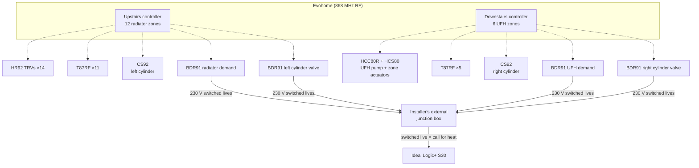

# A1 · System Design

[← Back to README](../README.md)

## The building and plant

| Item | Detail |
|---|---|
| House | Built around 2017; three storeys |
| Boiler | **Ideal Logic+ S30** (system boiler) |
| Hydronic layout | **S-plan**: 230 V switched-live control, separate circuits for radiators, underfloor and two hot-water cylinders |
| Heat emitters | Radiators (first/second floor), wet underfloor heating (ground floor) |
| Hot water | **Two unvented indirect cylinders** (Centre Store 250 L), "left" and "right" |
| Original controls | Basic room stat wiring plus a hot water timer box in another room |
| Smart controls | Honeywell **Evohome**, self-installed in **2018** |

## Control architecture: two controllers, one boiler

The house is split into two independent Evohome systems, each with its own controller, zones and cylinder:

| | Upstairs controller (01:000001) | Downstairs controller (01:000002) |
|---|---|---|
| Heats | Radiators, 12 zones | Underfloor, 6 zones |
| Zone control | **HR92 TRVs** on every radiator; **T87RF** wall stats as room sensors | **HCC80R** UFH controller + **HCS80** expansion driving the manifold actuators; T87RF wall stats as room sensors |
| Boiler demand | BDR91 (13:000002) | BDR91 (13:000004) |
| Hot water | Left cylinder: **CS92** sensor + BDR91 (13:000001) driving its zone valve | Right cylinder: **CS92** sensor + BDR91 (13:000003) driving its zone valve |

## Key design decisions

### 1. TRVs and HCC80R do the zoning; the relays keep the S-plan valves
On the **radiator** circuits, the TF and MF zone-valve heads are **still fitted but electrically disconnected, with their manual override latched** (held open, possibly not fully). Each radiator's **HR92 TRV** controls its own output, and the radiator BDR91 **calls the boiler directly**.

The **underfloor** circuit is different (corrected by the Oct 2026 survey, [A4](A4-junction-box-survey-and-wiring.md)): its BDR91 **drives the UF zone valve**, and the boiler fires from that valve's **end switch**. The **HCC80R** runs the UFH pump and the individual manifold actuators.

### 2. Wall stats as the room sensor
Every zone with a T87RF uses it as a **remote sensor**. Room temperature is measured at a sensible height away from the radiator, while the controller still drives the TRV or actuator. One radiator zone uses its TRV's own sensor; one UFH zone (Kitchen) uses the controller's built-in sensor.

### 3. Hot water via the Evohome DHW kits
Each controller has a DHW kit: a **CS92** cylinder sensor and a **BDR91** switching that cylinder's **2-port zone valve**. Each relay switches the **Danfoss TS715Si's output** (terminal A), not a permanent live, so the timer (on permanent ON) still gates hot water. The relay output passes through the cylinder's **stat and manual-reset cut-out** to the zone valve, and the boiler fires from the valve's **end switch**, the standard S-plan arrangement (traced in [A4](A4-junction-box-survey-and-wiring.md)). Sensor placement is covered in [A3](A3-dhw-cylinders-and-sensor-placement.md).

### 4. Boiler untouched
All four BDR91s were wired into the **existing external junction box** fitted by the original installer, replacing the old timer and room-stat switching. The boiler wiring was never touched. All four demands reach the boiler's single switched-live input: the radiator relay directly, the other three through their valves' end switches ([A4](A4-junction-box-survey-and-wiring.md#2-what-calls-the-boiler)).

### 5. Two systems, not one
Splitting radiators and underfloor across two controllers gave room for 18 zones and two DHW circuits. It has consequences:
- Two RF systems to bind and maintain.
- **OpenTherm limitation:** a boiler has one OpenTherm master, so two Evohome controllers can't both use Evohome's OpenTherm bridge. That drives the planned approach in the [roadmap](D1-roadmap.md).

## Underfloor heating detail

| Item | Detail |
|---|---|
| Location | Ground-floor plant space by the manifold (also houses the consumer unit) |
| Hydraulics | Mixing (blending) valve → pump → flow manifold with flow meters → loops → return manifold |
| Controller | HCC80R (02:000001) + HCS80 3-zone expansion, 6 zones |
| Zone order on the HCC80R | 1 Lounge · 2 Family Room · 3 Kitchen · 4 Dining · 5 Hall · 6 Utility |
| Demand | HCC80R runs the pump and actuators; the downstairs BDR91 drives the UF zone valve, whose end switch calls the boiler |

## Known plant issues (under investigation)

| Issue | Current understanding | Next step |
|---|---|---|
| Tundishes drip when hot water is used | Likely failed DHW expansion vessels and/or pressure relief valves on the unvented cylinders | Plumber to replace both vessels and both relief valves; cylinder inlet pressure gauges and tundish drip sensors to confirm ([D1](D1-roadmap.md)) |
| Slow loss of heating-system pressure | Not the boiler's expansion vessel: recharged, and its diaphragm isn't leaking | Trend the new boiler pressure gauge; isolate circuits to locate it |
| Missing pipe lagging in places | Avoidable heat loss on primaries and DHW | Complete the lagging |
| **No automatic bypass** despite TRVs on every radiator and five two-port valves | The boiler manual requires one ([A6](A6-pump-overrun-and-bypass.md)) | Read the fault history for L1 lockouts; Gas Safe engineer to fit an ABV or one open radiator |
