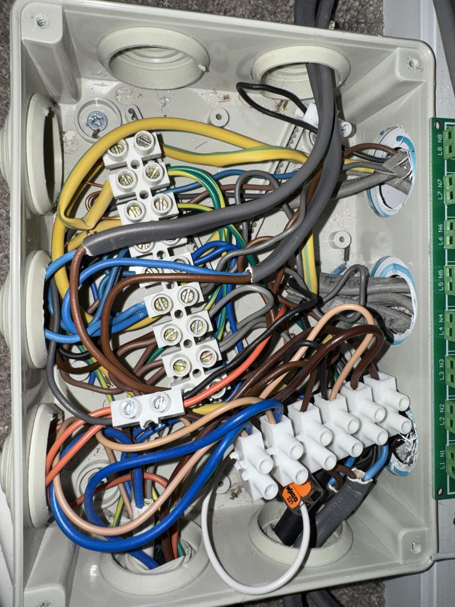
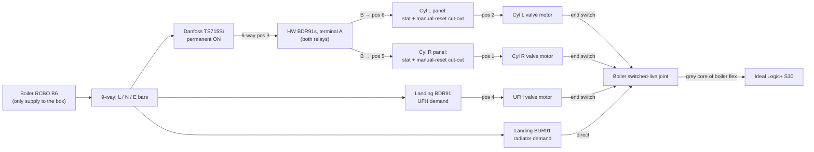
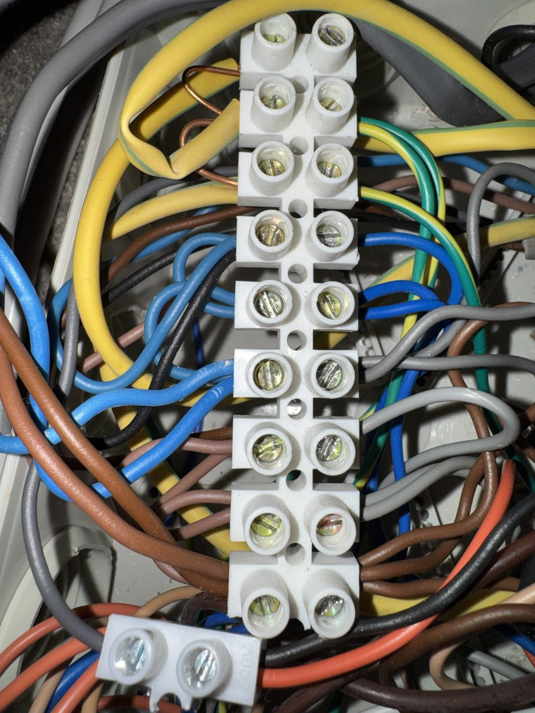
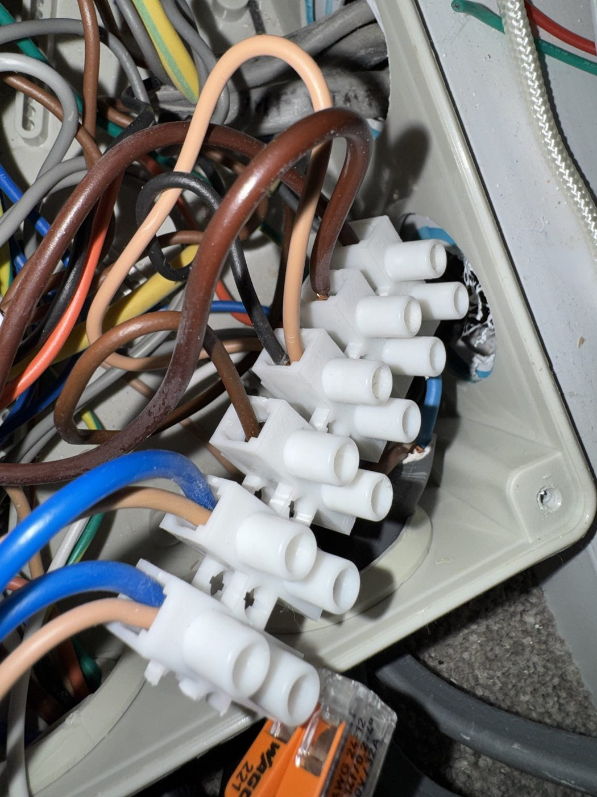
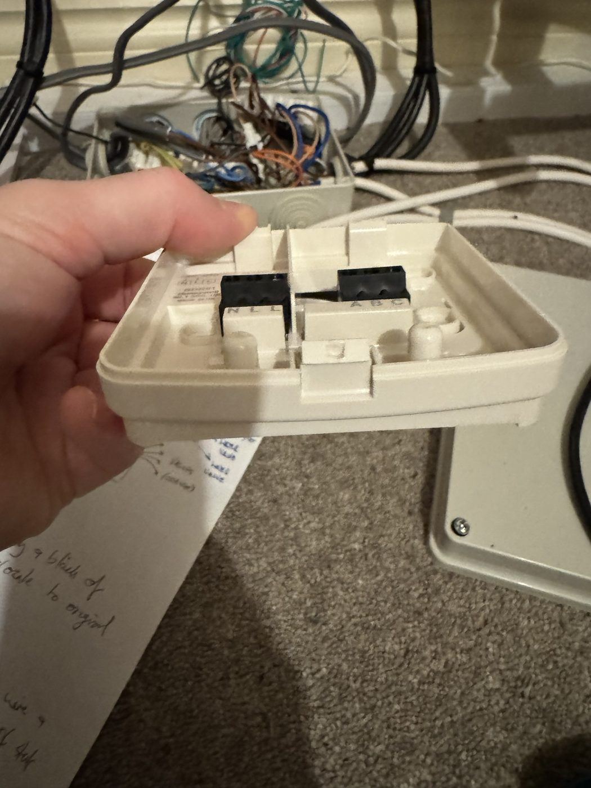
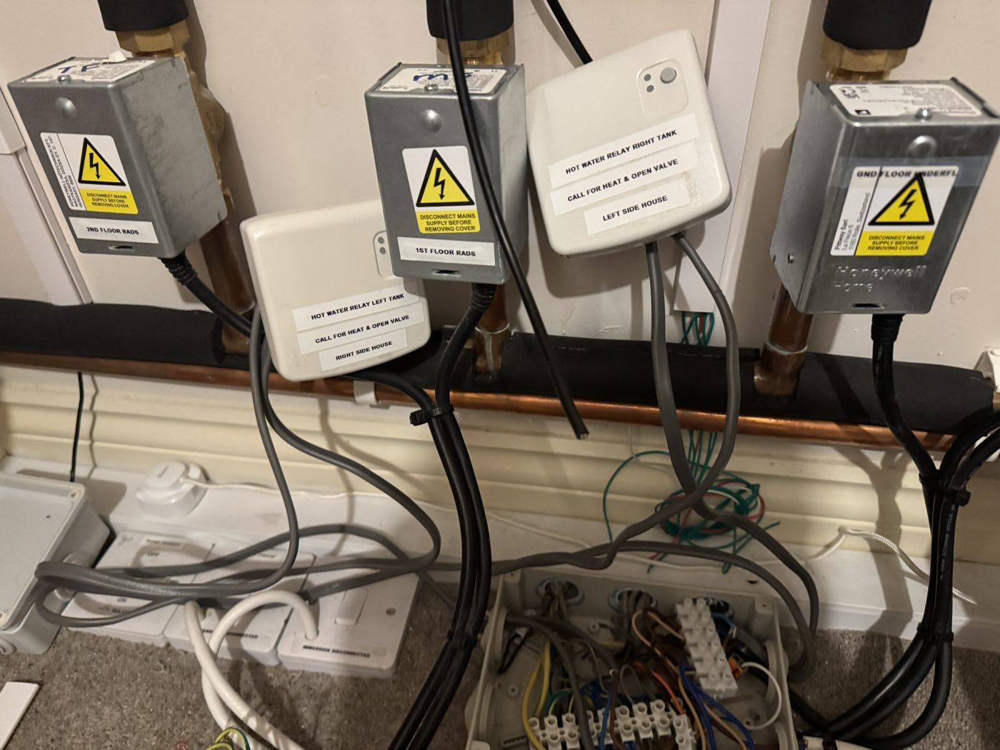

# A4 · Junction Box Survey: How the Controls Are Actually Wired (29 Oct 2026)

[← Back to README](../README.md)

The 2018 install was done from a handwritten sketch and memory. In October 2026, after completing a **Resideo heating controls wiring course** (S-plan, Y-plan, Evohome, TPI), I isolated the plant and traced the installer's junction box **terminal by terminal**. This document is the result: the system as it really is, which corrects several assumptions in [A1](A1-system-design.md) and the README. Side-by-side schematics of the as-built, Evohome and planned stages are in [A8](A8-wiring-schematics-three-stages.md).

## 1. Safe isolation

| Step | Detail |
|---|---|
| Point of isolation | Consumer unit: **Wylex B6 30 mA RCBO labelled "Boiler"**. Locked off / labelled while work is in progress |
| Instrument | AstroAI DM6000AR multimeter (CAT III 600 V). No LoZ or NCV function, so readings were interpreted with that in mind |
| Prove the meter | 240 V measured L-N and L-E at a box terminal with the circuit **on** |
| Prove dead | Every terminal to earth **below 0.6 V** with the RCBO off |
| Residual readings | 3.5 V on the switched-live joint and 14.4 V on the hot-water feed: **induced (capacitive) pickup** on long parallel runs, not a supply. Confirmed because the timer was dark and the BDR91s were unpowered |
| Finding | **The boiler RCBO is the box's only supply**, and the Danfoss TS715Si timer is on the same circuit |
| Second supply | Each cylinder's wiring panel also carries the **immersion supply** from a separate **Wylex B16 30 mA RCBO ("Water heater")**. Isolate both before opening a cylinder panel |

A high-impedance meter can show tens of volts on a dead conductor that runs alongside live ones. With no LoZ mode, the cross-checks (timer and relays unpowered, reading collapsing under a test load) are what make the "dead" result trustworthy.

## 2. What calls the boiler

All four Evohome relays ultimately energise one **boiler switched-live joint**, but by **different routes**:

| Demand | Relay | Path | Boiler fired via |
|---|---|---|---|
| **Radiators** (1st + 2nd floor) | Landing BDR91 on the old **TF stat cable** | Relay output (black) straight into the boiler switched-live joint | **Directly** (TF/MF valve heads disconnected, override latched) |
| **Underfloor** | Landing BDR91 on the old **MF stat cable** | Relay output (black) joins the **UFH valve motor** core (6-way pos 4) | The UFH valve's **end switch** |
| **Cylinder L** | Plant-room BDR91 "call for heat & open valve" | Relay out (6-way pos 6) → cylinder panel stat + cut-out → pos 2 → valve motor | Cylinder L valve **end switch** |
| **Cylinder R** | Plant-room BDR91 | Relay out (pos 5) → panel → pos 1 → valve motor | Cylinder R valve **end switch** |

**Two findings that change the documented design:**
1. **The UFH relay is not a "boiler call only".** It drives the **UFH zone valve**, and the boiler fires from that valve's end switch, the as-built S-plan behaviour.
2. **The timer still gates hot water.** The TS715Si output feeds **terminal A of both hot-water BDR91s**. It sits on permanent ON, but if it's ever switched off (or loses its setting after a power cut), **neither cylinder can heat**, whatever Evohome asks for. Checking it is on permanent ON is now part of every re-energisation.

## 3. Terminal map

### 9-way strip: distribution bars (counted from the right)

| Pos | Cores | Function |
|---|---|---|
| 1-3 (linked) | All browns: incoming supply (pos 3), boiler permanent live, feeds to the controls; plus **greys to both cylinder valve end switches** (pos 2) and the **UFH valve end-switch grey** (pos 3) | **Permanent live** |
| 4-6 (linked) | All blues; plus **greys from the stat cables** (landing BDR91 neutrals) at pos 4 and the **boiler flex black** at pos 6 | **Neutral** |
| 7-9 (linked) | Earths, looped with a bare copper link | **Earth** |

### 6-way strip: control joints

| Pos | Cores | Function |
|---|---|---|
| 1 | Cyl R panel blue + cyl R valve motor | Right stat output → right valve |
| 2 | Cyl L panel blue + cyl L valve motor | Left stat output → left valve |
| 3 | **TS715Si output (brown)** + both HW relays' **A** feeds | Hot-water feed to both relays |
| 4 | MF stat cable black (UFH relay output) + UFH valve motor | UFH relay → UFH valve |
| 5 | Cyl R relay **B** + cyl R panel brown | Right relay output → right stat |
| 6 | Cyl L relay **B** + cyl L panel brown | Left relay output → left stat |

### Boiler switched-live joint (separate 2-way block)
Boiler flex **grey** (switched live) + cylinder L, cylinder R and UFH valve **end-switch** cores + the **radiator relay output** (TF stat cable black).

### Cables and core colours

| Cable | Cores |
|---|---|
| Incoming supply | Brown → 9-way pos 3, blue → pos 6, earth → pos 9 |
| Boiler (older 3-core flex) | **Brown = permanent live**, **black = neutral**, **grey = switched live** |
| Old stat cables (TF, MF), now feeding the landing BDR91s | **Brown = live**, **grey = neutral**, **black = call/output** |
| Danfoss TS715Si cable | Brown → 6-way pos 3 (timer output); **black and grey left floating by the original installer** (to be capped and labelled) |
| UFH valve head | Honeywell Home **40003916-001** (V4043H replacement powerhead). Its **white N/C core is unused in S-plan** and is capped in a Wago 221, per the manufacturer's instructions |

## 4. The BDR91s

| Relay type | N | L | Second L | A (common) | B (N/O) | C (N/C) |
|---|---|---|---|---|---|---|
| **Landing** (radiator, UFH) | Grey (stat cable neutral) | Brown (stat cable live) | Brown **link to A** | Live via the link | **Black out** (call) | Unused |
| **Plant room** (cylinder L, R) | Blue | Brown | Spare | **Brown from the timer** (6-way pos 3) | **Blue out** to the cylinder panel | Unused |

The landing relays switch their own permanent live (L linked to A). The hot-water relays switch the **timer's** output instead, which is why A can't simply be linked from L on those two.

## 5. Cylinder wiring panels

Both cylinders have an identical lower panel with two module positions:

| Module | State | Role |
|---|---|---|
| **Boiler control** | **Fitted**: adjustable cylinder stat + **manual-reset overheat cut-out** | **In series with the cylinder's valve motor**: a tripped cut-out closes the valve whatever Evohome does |
| **Element control** | **Empty** since the Evohome install | Immersion thermostat + cut-out (Cotherm). Must be refitted before the immersion is ever used: see [A7](A7-immersion-backup-swap-procedure.md) |

Panel connector block (positions 1-6 from the left): 1 = switched live in from the HW relay, 2 = out to the zone valve after the stat and cut-out, 3 = internal to the boiler-control module, **4 / 5 = immersion L / N (top side empty: the Cotherm leads land here)**, 6 = earth.

> ✅ **Safety item closed:** both unvented cylinders' high-limit cut-outs are confirmed **fitted, sensing, and wired in series** with their zone valves.

## 6. Other findings

| Finding | Consequence |
|---|---|
| **Colours used against their function:** blues carrying switched live (HW relay B outputs, cylinder panel returns); greys and the boiler black working as neutrals | Re-identify with **brown / blue sleeving at both ends** during the tidy-up |
| Danfoss black and grey floating | Cap separately (Wago 221-412) and label; test to earth once powered |
| Green **L1/N1-L8/N8 board** beside the box | The planned plant-monitoring **opto input board**, fitted but not yet wired ([plant monitoring repo](https://github.com/the-control-cabinet/heating-plant-monitoring-esphome)) |
| Builder-installed intruder alarm on its own B6 RCBO, off | Unused; not related to the heating |
| Smoke/heat/CO alarms on a separate circuit | Unaffected by heating isolation |
| Hot-water BDR91s on stiff twin-and-earth, loose on the wall | Re-run in heat-resistant flex in trunking (below) |

## 7. Planned tidy-up (box still isolated)

| Item | Specification |
|---|---|
| Hot-water BDR91 re-wire | One **3095Y 5-core 0.75 mm² heat-resistant flex (H05V2V2-F, BASEC)** per relay: brown → L, blue → N, black → A (from the timer), grey → B (out), G/Y capped at the relay (BDR91 is double-insulated). 0.75 mm² is protected by the B6 RCBO |
| Relay mounting | Each BDR91 on a **D-Line 1-gang 32 mm surface pattress** with knockouts for **25×16 mini trunking**; the 5-core splits inside the pattress to the BDR91's two rear openings |
| Crowded joints | Choc blocks kept for the bars and two-core joints (single or twin ferrules). **Wago 221** only where an opto tap pushes a joint past two cores: 6-way pos 1, 2, 3 and the boiler switched-live joint |
| Opto taps | Boiler switched live, timer output, and both cylinders' **stat-passing** points (pos 1, pos 2); relay states come from RAMSES-II. See the plant monitoring repo |
| Identification | Sleeving as above; every cable labelled at both ends; strip positions and Wagos labelled; lid label naming both isolation points |
| Verification before re-energising | Continuity of every moved joint against this map; then **TS715Si on permanent ON**, BDR91s reporting in HA, heating and hot water both run |
