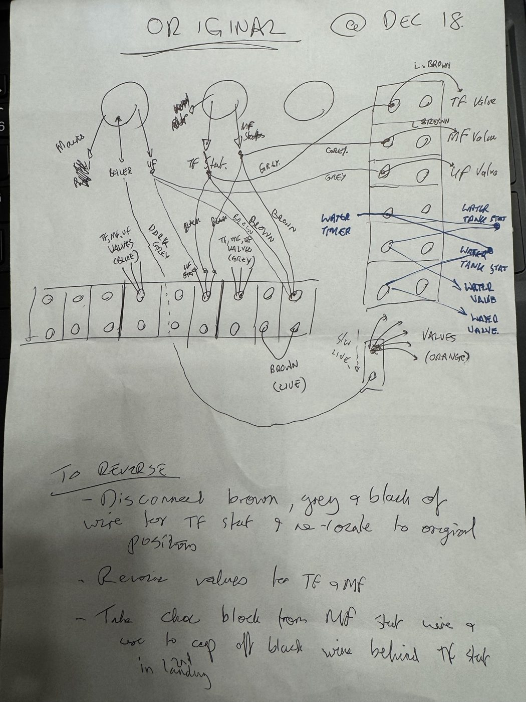

# A5 · As-Built Controls vs Evohome, and How to Reverse It

[← Back to README](../README.md)

A documented way back is part of any controls change. This records how the house was controlled **before** the 2018 Evohome install, what changed, and the procedure to restore the original controls. Sources: my December 2018 handwritten notes, my recollection, and the October 2026 survey ([A4](A4-junction-box-survey-and-wiring.md)), which overrides the notes where they differ.

Schematics for each stage: [A8](A8-wiring-schematics-three-stages.md).

## 1. As built: a standard S-plan

| Zone | Controlled by | Drives |
|---|---|---|
| 2nd-floor radiators (TF) | Wired room stat on the 2nd-floor landing | TF zone valve |
| 1st-floor radiators (MF) | Wired room stat on the 1st-floor landing | MF zone valve |
| Underfloor (UF) | Heatmiser battery room stats via a Heatmiser UFH controller | UF zone valve |
| Cylinder L / R | Each cylinder's own stat (boiler-control module), enabled by the Danfoss TS715Si | Cylinder L / R zone valve |

Any valve reaching fully open fired the boiler through its **end switch**. When every zone was satisfied, **all five valves closed** and the boiler's pump ran its overrun with no open zone: see [A6](A6-pump-overrun-and-bypass.md).

## 2. What Evohome changed

| Element | As built | Now |
|---|---|---|
| TF and MF zone valves | Heads wired, opened by the landing stats | **Heads still fitted, electrically disconnected, manual override latched** (held open, possibly not fully) |
| Radiator room control | One wired stat per floor | **HR92 on every radiator**, T87RF wall stats as remote sensors |
| Radiator boiler call | TF/MF valve end switches | **Radiator BDR91** at the 2nd-floor landing, on the old TF stat cable, straight into the boiler switched live |
| UFH | Heatmiser controller → UF valve | **HCC80R + HCS80**; **UFH BDR91** at the 1st-floor landing, on the old **MF** stat cable, still driving the UF valve |
| Hot water | Timer → cylinder stats → valves | Timer (permanent ON) → **HW BDR91s** (terminal A) → cylinder stats and cut-outs → valves. **Cylinder safety path unchanged** |
| Cylinder sensing | Cylinder stats only | **CS92** in each cylinder's element-head top pocket (in place of the immersion stat, see [A3](A3-dhw-cylinders-and-sensor-placement.md)) |
| Immersion element control | Fitted | **Removed** and stored |

## 3. Reversal procedure

**Parts:** two wired room stats for the landings; the Heatmiser UFH controller and stats (or equivalents); nothing for the valves (heads still fitted).

1. **Prepare:** photograph and label everything; isolate the **Boiler B6 RCBO** (and the **Water heater B16** if opening cylinder panels); prove dead; identify cores **by test, not colour** (the stat cables are repurposed).
2. **Remove Evohome:** disconnect the four BDR91s; remove the two landing relays from the TF and MF stat cables; remove the HCC80R wiring from the UF circuit.
3. **Radiator zones:** reconnect the TF and MF valve heads (brown motor → their 6-way positions, blue → neutral bar, grey → live bar, orange end switch → boiler switched-live joint) and **release the manual-override paddles**; refit the landing stats on the stat cables (brown live, grey neutral, black call). At the 2nd-floor landing, remove the cap from the black core (2018 note 3).
4. **Underfloor and hot water:** reconnect the Heatmiser controller's call to the UF valve; feed the cylinder stats from the timer directly (as the HW relays do now via terminal A); **set the TS715Si schedule** (cancel permanent ON).
5. **Commission:**

| Test | Pass when |
|---|---|
| Each room stat calls (one at a time) | Its valve opens, the end switch closes, the boiler fires |
| Each stat satisfied | Its valve closes; the boiler stops if nothing else calls |
| Each cylinder stat calls | Its valve opens and the boiler fires |
| Timer OFF | Neither cylinder valve opens |
| Cylinder cut-out tripped | Its valve closes |
| No calls anywhere | No switched live at the boiler |

The 2018 notes' three reversal steps (return the TF stat cable cores; re-wire the TF/MF valves; move the choc block that caps the TF black at the landing) are folded into steps 3-4.
