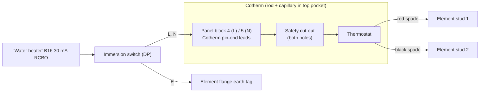

# A7 · Immersion Backup: Swapping the Cotherm Back In

[← Back to README](../README.md)

## Why a swap
Each cylinder's **lower element head** has two pockets:

| Pocket | Holds | Rule |
|---|---|---|
| **Top** | The **Evohome CS92** since 2018 (originally the Cotherm's rod and capillary) | Shared by the CS92 and the Cotherm, **never both** |
| **Bottom** | The **boiler-control module's** stat and overheat cut-out probes | **Safety-critical: never add anything** |

The Cotherm element control (combined thermostat + safety cut-out, copper **rod** for the stat, coiled **capillary** for the cut-out) fills the top pocket, so the two can't share it. Sharing would also risk the cut-out capillary not seating, which is unacceptable on an unvented cylinder. The immersion is only a backup for boiler failure, and with the boiler down Evohome's hot-water control has nothing to switch, so **they are swapped as needed**.

Moving the CS92 elsewhere isn't attractive: the upper panel's opening (about ⅗ height) has no pocket, and a high sensor brings back the stratification problem the lower position avoids ([A3](A3-dhw-cylinders-and-sensor-placement.md)).

## Cylinder and parts
Centre Store unvented indirect 250 L (Wolseley own brand, product code 176705), ×2. **The manufacturer's immersion wiring diagram is the authority**; obtain it before the first swap. The two Cotherms are stored bagged and labelled.

**Cotherm leads:** a red and a black with **pin ends** (to panel connector block 4 and 5) and a red and a black with **6.3 mm spade tabs** (to the element studs). No L/N marking on the body.

## Pre-check (bench, unpowered)
Continuity at room temperature with the cut-out reset: **red to red** and **black to black** continuous, **red to black** open. That proves each colour is one pole through the stat and cut-out. If red-to-red is open, the cut-out has tripped or the unit is faulty: don't fit it.

## Fit (boiler failed)
1. Isolate **Boiler B6** and **Water heater B16**; lock off; prove dead at the lower panel.
2. Remove the CS92 from the top pocket; wipe off the paste; coil and label it.
3. Insert the Cotherm's rod and capillary **fully** into the top pocket (don't kink the capillary); seat and secure the unit in the **Element control** position.
4. Spade leads to the two element studs; refit the stud covers.
5. Pin leads: **red → connector block 4 (L)**, **black → 5 (N)**. Confirm the element earth on the flange tag.
6. Set the thermostat to about **60 °C**; refit the cover; restore B16; switch on. Check it heats and cycles.

## Reverse (boiler fixed)
1. Isolate B16; prove dead; remove and re-bag the Cotherm.
2. Refit the CS92 to the bottom of the top pocket **with heat-transfer paste**; plug the pocket mouth with insulation.
3. Leave the element studs covered and the earth connected; refit the cover; **leave B16 off** and labelled "Immersions disconnected".
4. Confirm Evohome hot water reads and reheats normally.

**Never:** run the immersion without the Cotherm, put the CS92 in the bottom pocket, or try to fit both in one pocket.
