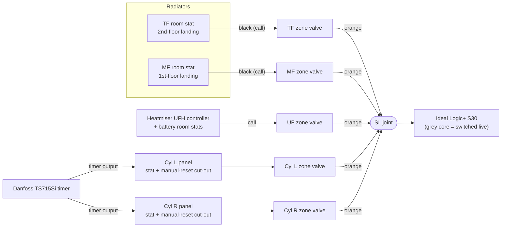
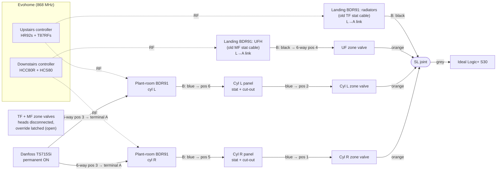
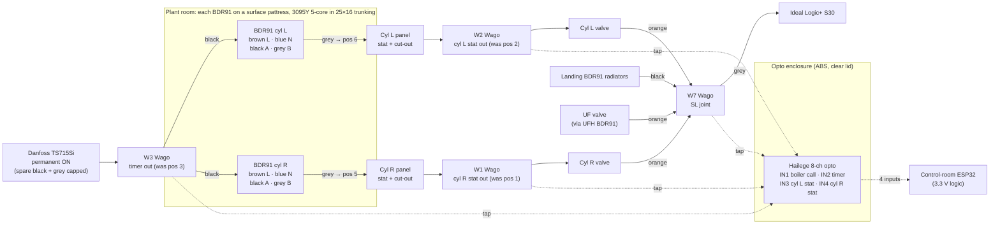

# A8 · Wiring Schematics: As Built, Evohome, and the 2026 Tidy-Up

[← Back to README](../README.md)

Three schematics of the same plant, drawn the same way so they can be compared directly:

| Stage | Period | Source |
|---|---|---|
| **1. As built** | 2017-2018 | 2018 handwritten notes, reconstructed with the 2026 survey's core colours |
| **2. Evohome** | 2018 to now | Surveyed terminal by terminal, 29 Oct 2026 ([A4](A4-junction-box-survey-and-wiring.md)) |
| **3. Tidy-up** | Planned, Nov 2026 | The changes in [A4 §7](A4-junction-box-survey-and-wiring.md#7-planned-tidy-up-box-still-isolated) and the [opto board install](https://github.com/the-control-cabinet/heating-plant-monitoring-esphome/blob/main/docs/11-opto-board-installation.md) |

**Conventions.** Every device takes **permanent live, neutral and earth from the 9-way bars** (not drawn, to keep the diagrams readable). Lines show **switched lives** only, labelled with the core colour where it matters. Zone valves: **brown = motor** (opens the valve), **grey = end-switch feed** (permanent live), **orange = end-switch out** (closes when the valve is fully open). "SL joint" = the boiler switched-live joint; the boiler fires when it's live.

## 1. As built (S-plan, 2017-2018)

Every heating and hot-water demand opens a valve; **only valve end switches** fire the boiler. When all five valves close, the pump overruns with no open zone ([A6](A6-pump-overrun-and-bypass.md)).

## 2. Evohome (2018 to now, as surveyed)

**What changed from stage 1:**
- The **landing stats became BDR91s** on the same cables: brown = live, **grey = neutral**, black = call.
- The **radiator relay feeds the SL joint directly**; the TF and MF valves are held open and their end switches are out of circuit.
- The **UFH relay replaced the Heatmiser call** but still drives the UF valve, so the UF end switch fires the boiler.
- The **hot-water relays sit between the timer and the cylinder stats**, switching the timer's output (terminal A). The cylinder stats and cut-outs stay in series; the timer still gates hot water.
- The **immersion element controls (Cotherms) were removed** and the CS92s took their pockets ([A3](A3-dhw-cylinders-and-sensor-placement.md)).

## 3. Planned tidy-up (2026)

The control logic is **unchanged**. What changes is how it's built, plus four monitoring taps.

**Changes in stage 3:**
- **Hot-water BDR91s** re-wired in **3095Y 5-core 0.75 mm² heat-resistant flex**, on pattresses, in trunking. With black on A and grey on B, **no blue carries a switched live** any more.
- **Four joints move to Wago 221s** to take an opto tap each; the 9-way bars and the other 6-way positions stay on choc blocks (twin ferrules where two cores share a terminal).
- **Opto board** in its own enclosure; neutral from the neutral bar; logic cable segregated to the ESP32. Relay states still come from RAMSES-II.
- **Identification:** remaining misused colours sleeved (landing greys and the boiler black → blue; landing blacks and cylinder panel blues → brown); Danfoss spare cores capped; every cable, strip position and Wago labelled.

## Where each stage is detailed

| Stage | Terminal detail | Procedure |
|---|---|---|
| As built | [A5 §1](A5-as-built-vs-evohome-and-reversal.md) | Reversal: [A5 §3](A5-as-built-vs-evohome-and-reversal.md#3-reversal-procedure) |
| Evohome | [A4 §3-5](A4-junction-box-survey-and-wiring.md#3-terminal-map), [terminal map CSV](../data/junction-box-terminal-map.csv) | n/a |
| Tidy-up | [A4 §7](A4-junction-box-survey-and-wiring.md#7-planned-tidy-up-box-still-isolated) | Opto install: [plant monitoring doc 11](https://github.com/the-control-cabinet/heating-plant-monitoring-esphome/blob/main/docs/11-opto-board-installation.md) |
