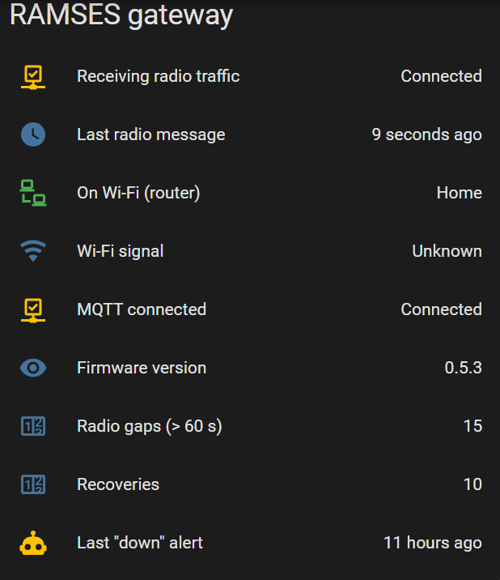
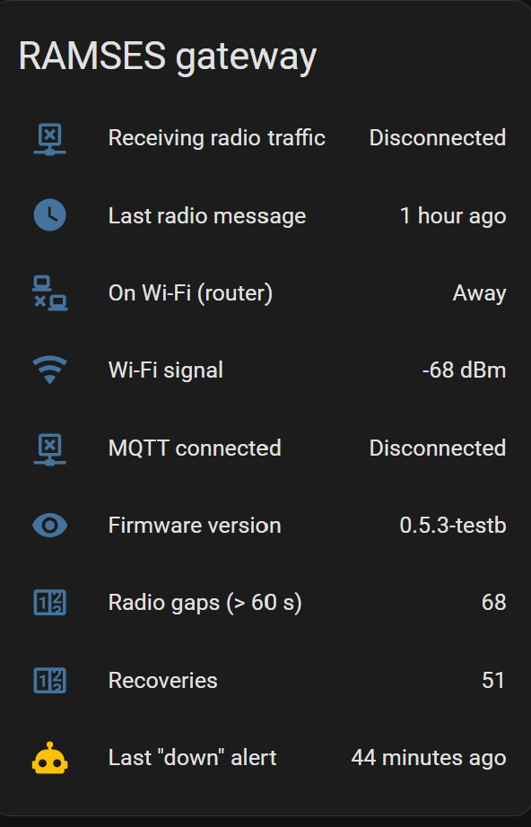
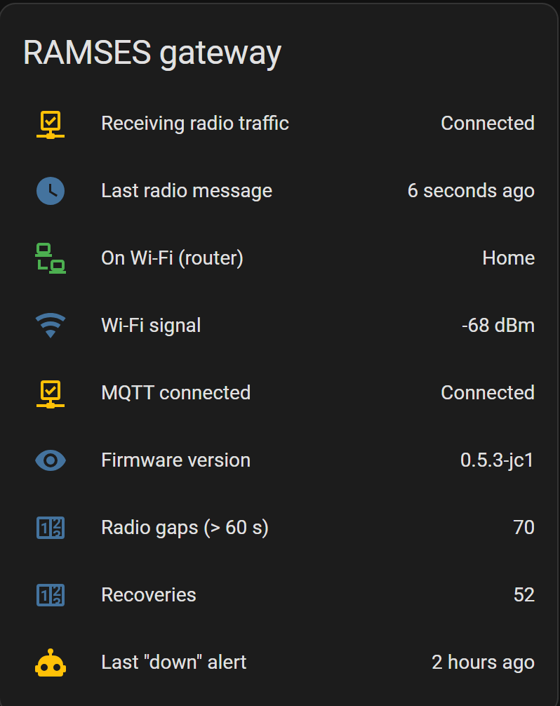

# 06 · Gateway Reliability Investigation

[← Back to README](../README.md)

**Status (6 Nov 2026): root cause found and fixed in a local test build.** The gateway periodically **stopped receiving RF while its Wi-Fi and MQTT stayed connected**. Serial logging, the maintainer's diagnostic builds and decoded backtraces traced it to a **transmit (TX) stall**: the radio task waits forever for a FIFO-refill interrupt that never arrives, and reception is switched off while it waits. A local build with the fix from upstream PR #44 (**0.5.3-jc1**) has run **two nights with no stalls**; the official fix is awaited upstream (sections 6-9).

## 1. History

| Phase | Symptom | Finding |
|---|---|---|
| Oct 2026, factory firmware | Gateway "offline" in HA after some hours; power cycle needed | Still answered ping and its serial console: Wi-Fi up, **MQTT not restored**. Stable on a laptop USB port (16 h+, 12.5 h+); unreliable on a wall adapter |
| Issue raised upstream (IndaloTech/ramses_esp #47) | Stick stops retrying Wi-Fi after a drop | Maintainer released a network-stability update at the end of October |
| 2 Nov 2026, updated firmware (flashed over USB, [B4](B4-upgrade-and-known-issues.md#gateway-firmware-update-usb-browser-flasher)) | **Wi-Fi reconnection now works**: the stick rejoined Wi-Fi by itself several times | But a **different fault** appeared: RF reception stops |

## 2. Monitoring built to measure it

The MQTT "online" status could not detect outages: the broker only noticed a dead connection when the stick reconnected, so "offline" and "online" arrived in the same second. Gateway health is therefore measured from **radio traffic**:

| Point | Source | Purpose |
|---|---|---|
| Last RX | MQTT sensor on the `/rx` topic, timestamped on every message | Time since the last RF packet |
| **Receiving** | Template binary sensor: last RX < 120 s ago | The real "gateway working" signal |
| MQTT online | `RAMSES/GATEWAY/<id>` (online/offline) | Connection state only |
| Firmware | `/info/version` | Version actually running |
| On Wi-Fi + signal | Router integration (AsusRouter) tracker and its RSSI | Separates a Wi-Fi drop from a hang |
| Gap and recovery counters, logbook entries | Automations | A record of every outage and its length |

Config: [sensors](../config/ha-gateway-monitoring.yaml) · [automations](../config/ha-gateway-automations.yaml) · [dashboard card](../config/ha-gateway-card.yaml).

## 3. The RF stall (updated firmware)

| Observation during a stall | Meaning |
|---|---|
| No `/rx` messages at all | Radio receive path stopped |
| MQTT connected; Wi-Fi connected at −62 to −64 dBm | **Not Wi-Fi, not signal, not MQTT** |
| Solid green LED | Matches another user's report (upstream #48); the maintainer separated this from a TX stall (blue LED, PR #44). **Later shown to be the TX LED on this stick: it *was* the TX stall** (section 7) |
| `cmd` published to the command topic returns `ESP_OK` | **CPU and MQTT task alive** |
| `reset` published to the command topic restarts it; RF resumes within about a minute | **Soft restart cures it**: no power cycle needed |
| Same fault on a PC USB port and on a wall adapter | **Not the power supply** |
| Wi-Fi dropped and rejoined several times during one stall, RF stayed dead | The Wi-Fi fix works; the radio side is separate |

**Timing pattern:** every stall so far began shortly after a reconnect or a burst of host activity (an HA restart, Wi-Fi access-point changes, a Wi-Fi rejoin), and the stick can **re-stall within minutes of a reset**. Event log: [data/gateway-rf-stalls.csv](../data/gateway-rf-stalls.csv).

Reported upstream as IndaloTech/ramses_esp **#50**, cross-referenced to #48 (same symptom) and #49 (MQTT reconnect memory leak).

## 4. Automatic recovery (watchdog)

An automation publishes `reset` when **Receiving** has been off **while MQTT is still connected** (the stall pattern). Since 4 Nov it makes **up to three resets per episode**, waiting 4 minutes for traffic after each, re-triggers every 10 minutes while the stick stays silent, and notifies only after **three consecutive failures** (a stick that re-stalls straight after a reset needs more than one attempt).

**Lesson from the first night:** a 15-minute "don't repeat" guard blocked the second reset when the stick re-stalled within minutes. The guard was unnecessary: the trigger is a **change** to "not receiving", so the watchdog can't loop on a stick that stays dead. It was removed.

## 5. Transmit is the trigger

With transmit disabled (`disable_sending: true`, listen-only), the stick ran **11¼ hours with no stalls**. With transmit on, it stalled every 4-30 minutes. So the stall needs the gateway to **send**: in practice, the integration's polling bursts (RQ/RP pairs to both controllers).



## 6. Serial capture

A small Python logger on the PC's USB port timestamps every line from the stick, and re-sends the debug filters every 5 minutes **and after every reboot** (the filters are lost on restart). Each stall then shows its lead-up and the task-watchdog **backtraces** (printed every 5 s while the radio task is stuck).

| Build | Period | Transmissions | Stalls |
|---|---|---|---|
| 0.5.3 (release) | 4 Nov 10:27-14:35 (4 h 8 min) | - | **16** (about every 15 min) |
| 0.5.3-testb (MQTT rewrite) | 4 Nov 15:36-18:19 (2 h 43 min) | - | **7**, one lasting 1 h 40 min (re-stalled straight after resets; power cycle needed) |
| 0.5.3-testc (testb + debug lines) | 5 Nov 09:08-09:36 | - | **4** in under 30 min; later one lasting ~7 h until reflashed |
| **0.5.3-jc1 (local, PR #44 + safety nets)** | **4 Nov 19:24 → 5 Nov 08:59 (13 h 35 min)** | **1,646** | **0** |
| **0.5.3-jc1, second night** | **5 Nov 19:51 → 6 Nov 09:31 (13 h 40 min)** | **1,687** | **0** |

Summary rows: [data/firmware-stall-comparison.csv](../data/firmware-stall-comparison.csv).

## 7. Decoding the stall

**testc's debug lines** (with `debug filter FRM info`, `CC1101 info`, `MQTT info`) show the same sequence every time:

```
12:34:49.240 MQTT: TX:<{"msg": "RQ --- 18:000001 01:000001 --:------ 30C9 001 00"}>
12:34:49.249 FRM: TX: START
12:34:49.252 CC1101: tx mode
12:34:49.253 FRM: TX: PREFIX
12:34:49.343 MQTT: MQTT_EVENT_PUBLISHED, msg_id=56897
12:34:54.250 Backtrace: ... (every 5 s)
```

- The CC1101 **reaches TX mode**: it isn't stuck in a mode-change loop.
- The frame loads its **prefix** and never reaches `TX: MESSAGE`.
- **MQTT carries on** normally on its own task.
- The controller's reply to the previous request was received just before: **RX was fine until the transmit**.

**The backtraces, decoded against the release's `.elf`** (`xtensa-esp-elf-addr2line`), all 163 of them:

| Frame | Function | Source |
|---|---|---|
| 1 | `Radio_Task` | main/radio.c:38 |
| 2 | `frame_work` | frame.c:698, `FRM_TX` case: `tx_fifo_work();` |
| 3 | `tx_fifo_work` | frame.c:445: `if( xQueueReceive( tx_isr_queue, NULL, 0 ))` |
| 4 | `xQueueReceive` | FreeRTOS queue.c, returning empty |

**So:** the radio task spins in `FRM_TX`, polling the "FIFO needs refilling" queue with a zero timeout, and the GDO0 interrupt that should fill it **never fires** (a missed edge). Reception is switched off for the duration of a transmit, so from outside it looks like an **RX stall**. The **TX LED** is switched on at the start of a frame and off at the end, which is why it stays **solid** (green on this stick) for the whole stall.

## 8. The fix under test: 0.5.3-jc1

Built locally from testb's source (ESP-IDF v6.0.3), with the change in **upstream PR #44** plus safety nets ([patch](../firmware/ramses_esp-jc1/jc1-changes.patch)):

1. **PR #44:** queue a refill event if the FIFO is already below its threshold after priming or refilling, so a missed edge can't leave the frame stuck.
2. A **500 ms TX timeout** that aborts a stuck frame and returns to RX.
3. **Limits** on the CC1101 mode-change loops and the TX prime loop.
4. **Task watchdog panic**, so any other stall reboots the stick instead of hanging.

**Result:** two nights and ~3,300 transmissions with **no stalls**, and the timeout and loop-limit warnings **never fired**. So **PR #44's change alone** prevents it; the safety nets are an unused backstop.

 

**Upstream:** the analysis, the decoded backtraces and both testc captures (one unfiltered) are on IndaloTech/ramses_esp **#50**. Built with AI assistance (disclosed on the issue). The stick stays on jc1, with Tx on and the watchdog kept, until an official release includes a fix.

## 9. Next steps

1. Flash the official build when the maintainer releases a fix; keep the watchdog and serial logging for a week afterwards.
2. Raise the "radio gap" counter threshold from 60 to 120 s: quiet RF spells of 60-107 s happen at night and aren't faults.
3. Gateway location and Wi-Fi: unchanged (−62 to −68 dBm).

## Lessons

- **Measure the service, not the connection.** "Connected" was true during every outage; only traffic told the truth.
- **Separate the variables:** supply (PC vs wall adapter), Wi-Fi (router RSSI and presence), MQTT (online status, command replies) and radio (RX) each have their own point.
- **A cheap test while it's broken is worth more than a restart.** One command (`cmd`) during a stall proved the CPU and MQTT were alive.
- **A workaround is a control, not a fix.** The watchdog kept the heating integration working; the fault was fixed at its source.
- **Change one thing at a time:** Tx off (no stalls), then each firmware build against the same stick, location and polling.
- **Symbols turn a backtrace into evidence.** The `.elf` made 163 hex addresses into one line of code.
- **What a symptom looks like isn't where it is.** "RX stops" was a stuck transmit with reception switched off.
