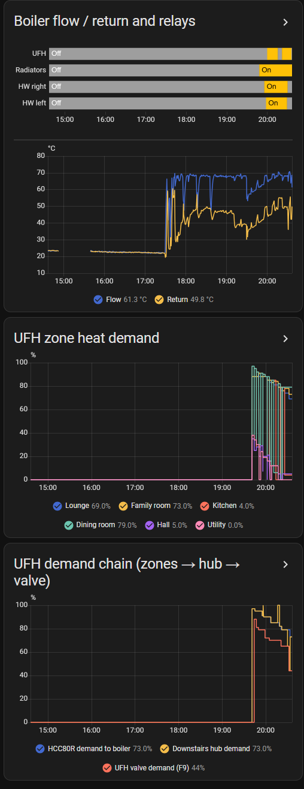
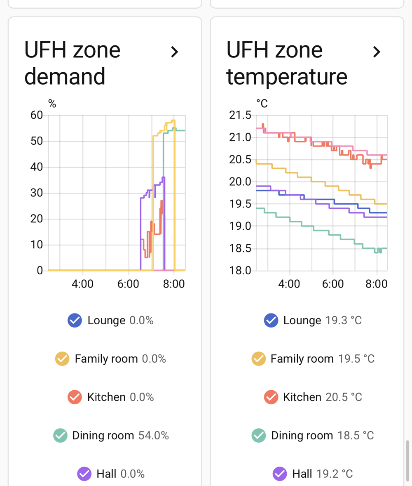
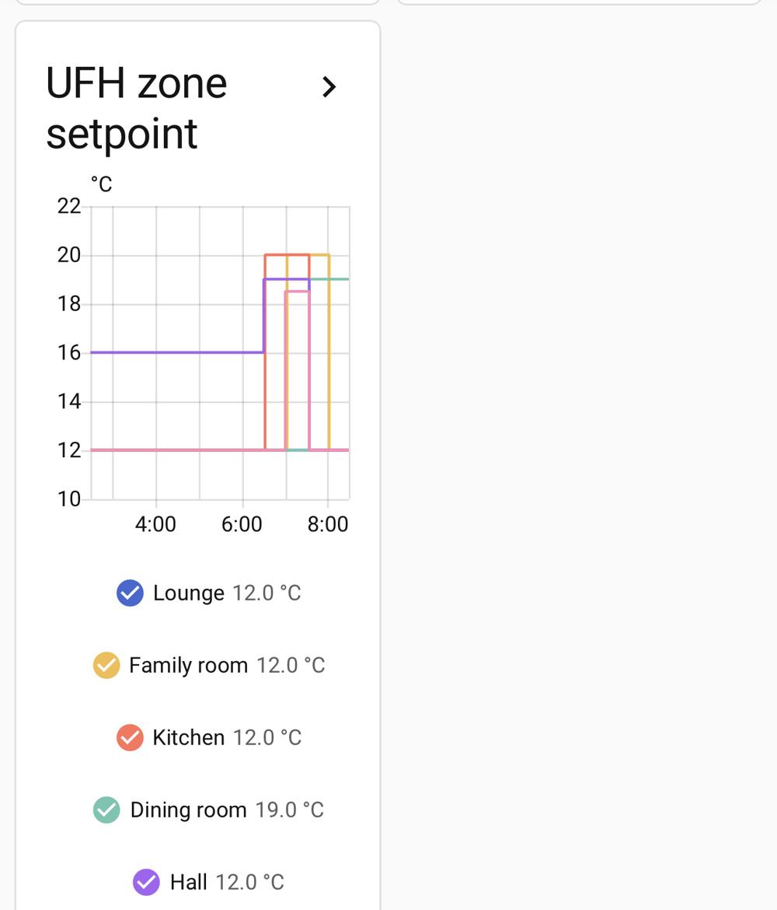
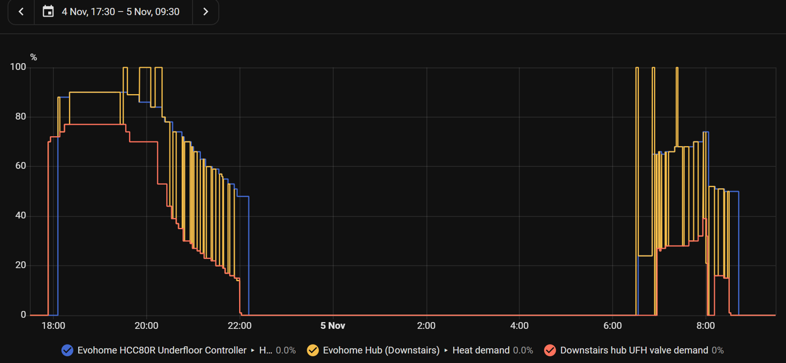

# B8 · Underfloor Demand: Decoding the HCC80R, and What the Data Shows

[← Back to README](../README.md)

**Summary (5-6 Nov 2026):** `ramses_cc`'s six underfloor "circuit" and zone heat-demand sensors were **unreliable**: each one showed a mixture of two different values. Decoding the HCC80R's messages showed why, gave **14 trustworthy sensors** built straight from the gateway's MQTT feed, and replaced a planned zone-by-zone test. With clean data, the zones, the hub and the UFH valve can be read together for the first time.

## 1. The symptom

On the dashboard, zones were calling for heat while **above** their setpoints ("Kitchen" at 76% while 1 °C over target), pairs of values matched one evening and not the next ("Kitchen 4%, Dining room 79%"), and a room at its setpoint, with its output LED off, showed 84%.

## 2. Two messages, two numberings

The HCC80R (`02:000001`) sends demand in **two** forms, both numbered from `00`:

| Message (code 3150) | Sent to | Numbered by | Example, 5 Nov 20:21-20:23 |
|---|---|---|---|
| Per-zone, length 002 (`ZZ DD`) | the downstairs controller (`01:000002`) | **Evohome zone**: 00 Lounge, 01 Family, 02 Kitchen, 03 Dining, 04 Hall, 05 Utility | 76, 79, 0, 0, 0, 0 |
| Broadcast, length 016 (8 × `II DD`) | itself (broadcast) | **HCC80R output 1-8** | 76, 76, 79, 79, 5, 0, 0, 0 |

Demand = `DD` ÷ 2 (%). **Read by their own numbering, they agree exactly**: outputs 1+2 (the Lounge's two actuators) carry the Lounge's 76%, outputs 3+4 the Family room's 79%, output 5 the Kitchen. That also **confirmed the output allocation** from the controller rebuild (1-2 Lounge, 3-4 Family, 5 Kitchen, 6 Dining, 7 Hall, 8 Utility).

**The cause:** `ramses_cc` updates the same six entities from **both** messages by number alone, so entity "02" shows the Kitchen zone's demand after one message and **output 3's** (the Family room) after the other, whichever arrived last.

## 3. The fix: sensors from the raw messages

A Home Assistant package ([config/ha-ufh-hcc80r-demand.yaml](../config/ha-ufh-hcc80r-demand.yaml)) uses MQTT-triggered template sensors on the gateway's `rx` topic:
- **Six zone demands** from the per-zone messages, each updating only from its own zone number.
- **Eight output demands** from the broadcast.
- **Zone temperatures and setpoints** as plain sensors (so graphs show clean lines rather than the climate entities' heating shading).

First check after loading: Lounge 56% = outputs 1 and 2 (56%, 56%); Family room 56% = outputs 3 and 4; the rest 0%. The dashboard card is in [config/ha-ufh-dashboard-card.yaml](../config/ha-ufh-dashboard-card.yaml). The old `ramses_cc` underfloor demand entities are no longer used.

 

## 4. The UFH valve demand (F9)

The downstairs controller turns the zones' demand into an on-time for the UFH valve relay (`13:000004`), reported as its F9 relay demand. Over three heating periods, the relationship was the **same each time**, and steep:

| HCC80R demand to the boiler | F9 valve demand |
|---|---|
| ~95% | ~79% |
| ~90% | ~77% |
| ~86% | ~70% |
| ~78% | ~44% |
| ~70% | ~30% (evening **and** morning) |
| ~54% | ~18% |
| ~48% | ~15% |

So at **moderate** demand, the valve is open only a fraction of each 20-minute cycle. The relay was seen to follow F9 correctly (e.g. ~13 min on, 8 off at ~66-72%).

## 5. Related checks

| Question | Finding |
|---|---|
| Does hot water take priority over the UFH? | **No.** Over two evenings and a morning, the UFH relay kept cycling while the downstairs cylinder reheated. One skipped cycle at a reheat start (4 Nov, 19:29) didn't repeat |
| Is the radio link to the plant-room relays marginal? | The hub is two floors below them; the gateway (near the hub) hears the relays clearly. Hub signal test and fault log still to check |
| Why did the Family room take days to reach 20 °C? | Its second actuator was bound to the wrong zone until the rebuild; reached 20.1 °C on 5 Nov |

## 6. What the clean data suggests (not yet acted on)

- **Short morning boosts barely run the UFH:** on 6 Nov, the Family room's 07:00-08:00 period at ~54% HCC80R demand gave F9 ~18%, so about 12 minutes of valve time, and it didn't reach its setpoint.
- **Deep overnight setbacks (12 °C)** cost the slabs about 1 °C overnight, which hour-long boosts can't recover. Shallower setbacks usually suit UFH better.
- **Optimum start** began no zone early on 6 Nov: probably still re-learning after the controller rebuild on 3 Nov. Hold changes for about a week, then review the hub's UFH settings (cycle rate, minimum on-time), setbacks and comfort-period lengths against these graphs.

## 7. Addendum (14-17 Nov 2026): new output map, and a broadcast that got shorter

- **Outputs re-wired and re-bound (14 Nov)** so each room's loops sit on one output: **1 Kitchen, 2 Lounge, 3 Dining, 4 Hall, 5 Family room, 6 Utility, 7-8 spare**. The package's output sensor names follow this map; their entity IDs keep the old labels so history is kept.
- **Stray zones 7 and 8 (17 Nov).** Outputs 7 and 8 showed demand (mean 84 % and 23 % overnight) with nothing wired. The HCC80R's setpoint message (`22C9`) listed zones 7 and 8 at a fixed 20.00 °C, and their demand fitted two wall stats exactly (Hall and Utility, `34:000015` / `34:000016`): **old sensor bindings from the original setup** that the 14 Nov clear-down hadn't covered. Clearing them is in [B9](B9-ufh-and-radiator-behaviour.md#addendum-17-18-nov-2026-als-off-and-the-hcc80r-bindings).
- **The broadcast now lists only bound outputs.** Once 7 and 8 were cleared, the per-output broadcast changed from length `016` (8 outputs) to **`012` (6 outputs)**, and stops altogether when no output is calling. The package accepted only `016`, so the output sensors froze. The decoder now reads any length, treats an unlisted output as 0 %, and ignores the HCC80R's overall-demand message (`FC..`) sent to itself. Verified on `009601C802C803A004C80500` = Kitchen 75, Lounge 100, Dining 100, Hall 80, Family 100, Utility 0, matching the per-zone messages.

## 8. Addendum (19 Nov 2026): the curve is Evohome's own, not the binding or load scaling

**Conclusion.** The steep curve in [§4](#4-the-ufh-valve-demand-f9) is how the Evohome controller itself turns zone demand into relay demand. It follows the **highest** zone demand (not an average), is close to one-to-one above ~90 % and falls away steeply below it. It is the same on **both controllers** and for **both relay roles**, with advanced load scaling **disabled** on both. Rebinding the UFH relay would not change it.

**Evidence (packet log, 19 Nov mornings).** Raw 3150/0008 values are out of 200.

Downstairs controller `01:000002`, UFH relay `13:000004` bound as the S-plan **heating valve** (domain F9):

| HCC80R highest zone (3150 to the controller) | F9 to the UFH relay (0008) | Ratio |
|---|---|---|
| 59 % | 22 % | 0.37 |
| 62 % (`7C`) | 23 % (`2E`) | 0.37 |
| 63 % (`7E`) | 25 % (`32`) | 0.40 |

An average of the zones does not fit (four zones at 41-62 % still gave 23-24 %; one zone at 61 % alone gave 23 %).

Upstairs controller `01:000001`, radiator relay `13:000002` in the **boiler relay** role (domain FC):

| Highest radiator-zone demand | FC to the boiler relay | Ratio |
|---|---|---|
| 99 % (`C6`) | 98 % (`C4`) | 0.99 |
| 91 % (`B6`) | 79 % (`9E`) | 0.87 |
| ~51 % | 16 % (`20`) | 0.31 |
| 46 % (`5C`) | 12 % (`18`) | 0.26 |

The relay is on/off; the percentage is its TPI duty. At 3 cycles an hour, 23 % is **~4.6 min in every 20**, matching the UFH relay exactly (e.g. on 07:20:02, off 07:24:38; on 07:40:07, off 07:44:43). In the two-relay (S-plan) setup the controller sends FC only when hot water is calling (then 100 %).

**What it means.**
- **Radiators:** the curve is reasonable: radiators respond in minutes and each HR92 also throttles its own radiator.
- **Screed UFH:** it works against a slow floor. A room 0.7 °C under setpoint asks for ~60 %, gets ~23 % valve time and cannot catch up before the period ends. This explains the **mild-morning shortfalls** (19 Nov: Dining −0.7 °C with the UFH relay on 25 min, 03:00-10:30, against 204 min on the colder 18 Nov). Disabling load scaling (17 Nov) fixed the learned down-scaling on cold mornings; it cannot change this curve.

**Next (one change at a time).**
- [ ] Trial: Dining room weekday morning setpoint **19.0 → 19.5 °C**. A larger error lifts zone demand into the steep part of the curve (zone ~70 % gives ~30 % relay time, ~90 % gives ~77 %). Watch for overshoot once the slab catches up.
- [ ] Longer term: let Home Assistant decide the UFH relay from the actual zone demands, as part of the OpenTherm plan ([D1](D1-roadmap.md#opentherm-and-advanced-boiler-control-planned)).
