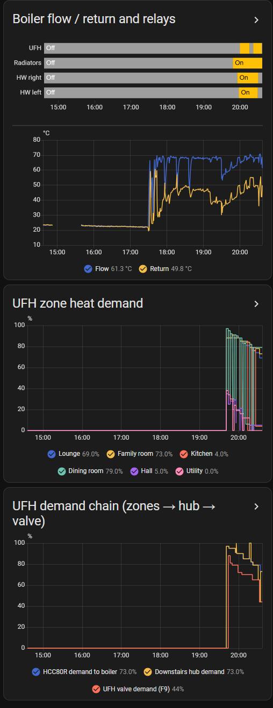
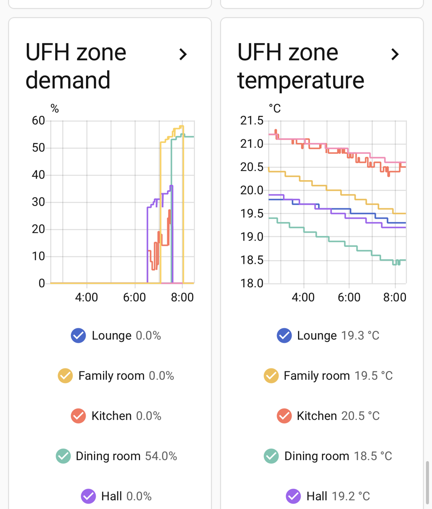
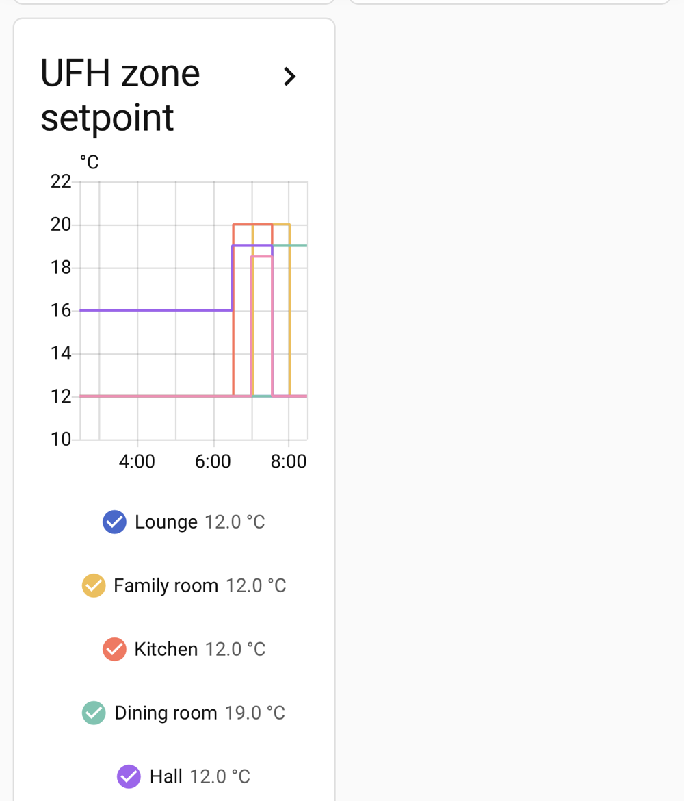
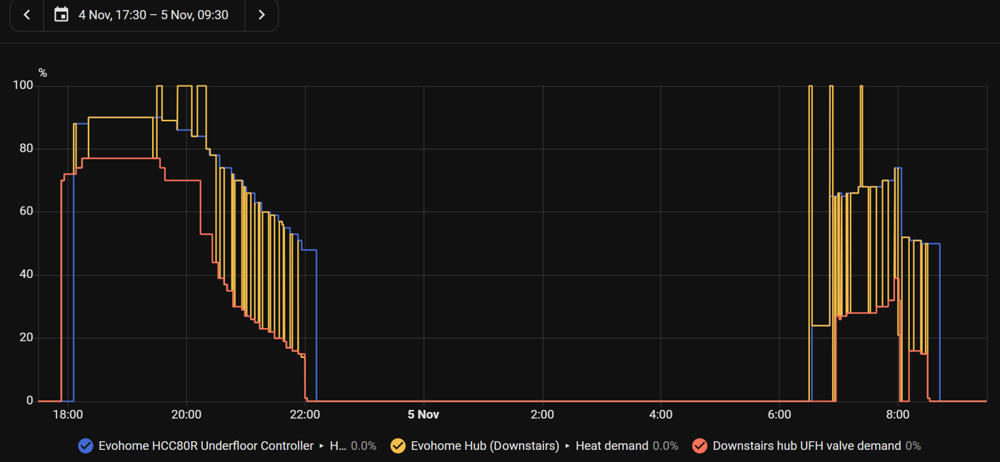

# B8 · Underfloor Demand: Decoding the HCC80R, and What the Data Shows

[← Back to README](../README.md)

**Summary (5-6 Nov 2026):** `ramses_cc`'s six underfloor "circuit" and zone heat-demand sensors were **unreliable**: each one showed a mixture of two different values. Decoding the HCC80R's messages showed why, gave **14 trustworthy sensors** built straight from the gateway's MQTT feed, and replaced a planned zone-by-zone test. With clean data, the zones, the hub and the UFH valve can be read together for the first time.

## 1. The symptom

On the dashboard, zones were calling for heat while **above** their setpoints ("Kitchen" at 76% while 1 °C over target), pairs of values matched one evening and not the next ("Kitchen 4%, Dining room 79%"), and a room at its setpoint, with its output LED off, showed 84%.

## 2. Two messages, two numberings

The HCC80R (`02:000001`) sends demand in **two** forms, both numbered from `00`:

| Message (code 3150) | Sent to | Numbered by | Example, 5 Nov 20:21-20:23 |
|---|---|---|---|
| Per-zone, length 002 (`ZZ DD`) | the downstairs controller (`01:000002`) | **Evohome zone**: 00 Lounge, 01 Family, 02 Kitchen, 03 Dining, 04 Hall, 05 Utility | 76, 79, 0, 0, 0, 0 |
| Broadcast, length 016 (8 × `II DD`) | itself (broadcast) | **HCC80R output 1-8** | 76, 76, 79, 79, 5, 0, 0, 0 |

Demand = `DD` ÷ 2 (%). **Read by their own numbering, they agree exactly**: outputs 1+2 (the Lounge's two actuators) carry the Lounge's 76%, outputs 3+4 the Family room's 79%, output 5 the Kitchen. That also **confirmed the output allocation** from the controller rebuild (1-2 Lounge, 3-4 Family, 5 Kitchen, 6 Dining, 7 Hall, 8 Utility).

**The cause:** `ramses_cc` updates the same six entities from **both** messages by number alone, so entity "02" shows the Kitchen zone's demand after one message and **output 3's** (the Family room) after the other, whichever arrived last.

## 3. The fix: sensors from the raw messages

A Home Assistant package ([config/ha-ufh-hcc80r-demand.yaml](../config/ha-ufh-hcc80r-demand.yaml)) uses MQTT-triggered template sensors on the gateway's `rx` topic:
- **Six zone demands** from the per-zone messages, each updating only from its own zone number.
- **Eight output demands** from the broadcast.
- **Zone temperatures and setpoints** as plain sensors (so graphs show clean lines rather than the climate entities' heating shading).

First check after loading: Lounge 56% = outputs 1 and 2 (56%, 56%); Family room 56% = outputs 3 and 4; the rest 0%. The dashboard card is in [config/ha-ufh-dashboard-card.yaml](../config/ha-ufh-dashboard-card.yaml). The old `ramses_cc` underfloor demand entities are no longer used.

 

## 4. The UFH valve demand (F9)

The downstairs controller turns the zones' demand into an on-time for the UFH valve relay (`13:000004`), reported as its F9 relay demand. Over three heating periods, the relationship was the **same each time**, and steep:

| HCC80R demand to the boiler | F9 valve demand |
|---|---|
| ~95% | ~79% |
| ~90% | ~77% |
| ~86% | ~70% |
| ~78% | ~44% |
| ~70% | ~30% (evening **and** morning) |
| ~54% | ~18% |
| ~48% | ~15% |

So at **moderate** demand, the valve is open only a fraction of each 20-minute cycle. The relay was seen to follow F9 correctly (e.g. ~13 min on, 8 off at ~66-72%).

## 5. Related checks

| Question | Finding |
|---|---|
| Does hot water take priority over the UFH? | **No.** Over two evenings and a morning, the UFH relay kept cycling while the downstairs cylinder reheated. One skipped cycle at a reheat start (4 Nov, 19:29) didn't repeat |
| Is the radio link to the plant-room relays marginal? | The hub is two floors below them; the gateway (near the hub) hears the relays clearly. Hub signal test and fault log still to check |
| Why did the Family room take days to reach 20 °C? | Its second actuator was bound to the wrong zone until the rebuild; reached 20.1 °C on 5 Nov |

## 6. What the clean data suggests (not yet acted on)

- **Short morning boosts barely run the UFH:** on 6 Nov, the Family room's 07:00-08:00 period at ~54% HCC80R demand gave F9 ~18%, so about 12 minutes of valve time, and it didn't reach its setpoint.
- **Deep overnight setbacks (12 °C)** cost the slabs about 1 °C overnight, which hour-long boosts can't recover. Shallower setbacks usually suit UFH better.
- **Optimum start** began no zone early on 6 Nov: probably still re-learning after the controller rebuild on 3 Nov. Hold changes for about a week, then review the hub's UFH settings (cycle rate, minimum on-time), setbacks and comfort-period lengths against these graphs.
