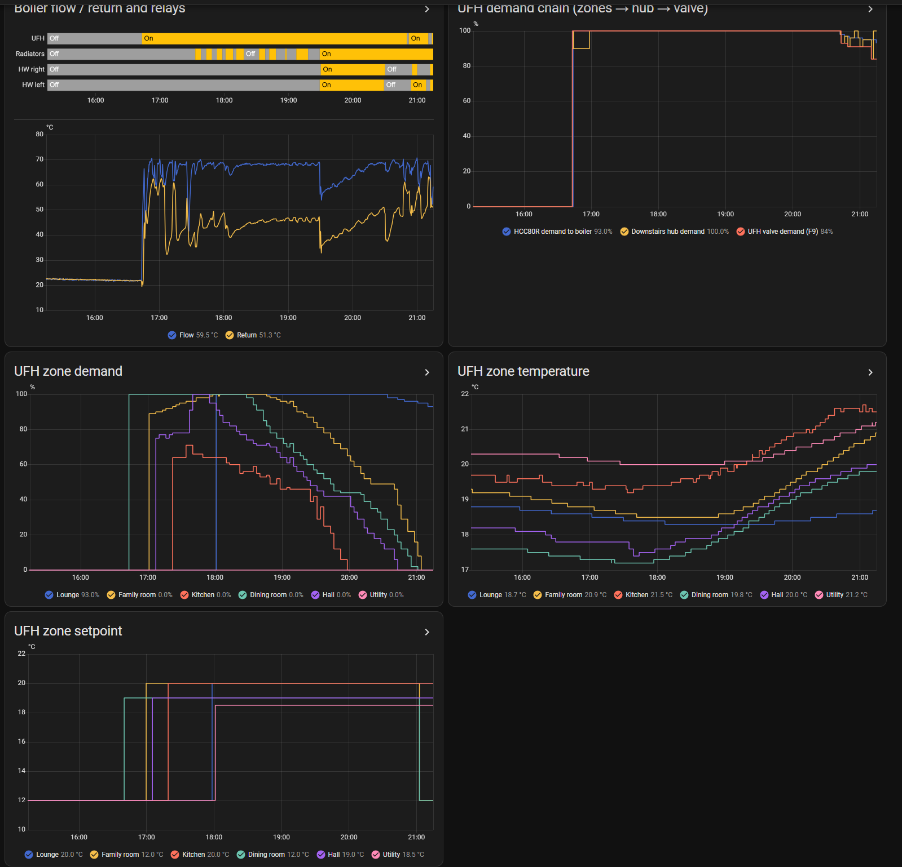

# B9 · UFH and Radiator Behaviour: ALS, Optimum Start and the Lounge Fault

[← Back to README](../README.md)

With trustworthy UFH demand ([B8](B8-ufh-demand-decoding.md)) and the plant-monitoring boiler states, the two hubs' behaviour can be measured rather than guessed.

## Advanced load scaling: Normal → Partial (downstairs hub, 7 Nov 2026)

ALS is set **per hub** and learns **per zone** (heat capacity), adapting over up to a week. Changed on the downstairs (UFH) hub only, with nothing else changed for a week.

| Observation | Normal (before) | Partial (after) |
|---|---|---|
| F9 UFH valve demand at HCC80R ~51% | - | ~16% |
| at ~64-71% | ~30% | ~26-35% |
| at ~75-78% | ~44% | ~52-55% |
| at ~84% | ~70% | ~65% |
| Optimum start lead (Lounge, weekday) | 30 min | 50 min |
| Dining room lead | 10 min | 30 min |

Optimum start (also per hub, learning per zone from heat-up rate, using predicted outside temperature) did **not** reset with the ALS change. Morning shortfalls remain (Dining 17.6-17.9 °C, Family 19.1-19.4 °C in 1-1.5 h windows): candidates are a longer morning period, a longer optimum-start limit (up to 3 h), or a higher setback (a one-zone test is planned, compared on heating degree days and gas use).

## The Lounge fault (from 8 Nov)

Floor stone cold all evening, although:
- the Lounge zone demand was **100%** for hours, HCC80R outputs **1 and 2** at 100% with LEDs on,
- the UFH relay was on continuously, with F9 at 100%, and the boiler firing.

So the controller, the HCC80R's commands and the hot water at the manifold are fine; the fault is **after** the HCC80R, or in its bindings. Two leads:

1. **A direct sensor binding:** during the 3 Nov rebuild, the Lounge T87RF's bind was caught by output 1's **sensor slot** (LED 1 flashing, then solid **red**). A red slot gives that output a second control source. Check: installation mode, step to LED 1's red slot, clear it, re-test.
2. **Heat going elsewhere:** the Family room kept rising after its own demand ended (to 21.1 °C on 9 Nov, 20.7 °C on 8 Nov) while the Lounge was calling. If outputs 1/2 actually open Family loops, the Lounge stays cold and the Family room overshoots. Check: with only the Lounge calling, follow which loops warm at the manifold.

### Evening of 11 Nov: a sharper lead

- The Lounge was at **93-100% demand from 18:00** (HCC80R and F9 at 100%, boiler firing) and rose only **18.0 → 18.7 °C** against 20 °C.
- **Leading hypothesis: the installer's loop labels are swapped between the Lounge and the Family room**, so each zone's outputs drive the other room's loops. That explains the Family room overshooting while the Lounge calls, and the Lounge's slow creep later from the Family room's earlier demand.
- **The Utility room** warmed ~19.3 → 21.2 °C (2.7 K over its 18.5 °C setpoint) with **zero demand all evening**: a second mislabelled loop, heat from the Kitchen, or appliances.
- Kitchen and Family room kept rising after their demand ended (UFH slab lag, partly).

**Test:** one zone at a time (others at minimum, ~20 min each): Lounge, then Family room, then Utility; note which loops' flow pipes warm at the manifold and which rooms they serve. **Fix:** swap the bindings or the actuator plugs, then re-check that the Lounge warms.

Status: open (loop test next).

## Addendum (12-16 Nov 2026)

- **Loop test (12 Nov):** with the Lounge at 25 °C and the Family room held at 12 °C, the *Family room* floor warmed and the Lounge stayed cold: the installer's "Lounge" and "Family room" loop labels were swapped. Fixed without mains work by clearing and rebinding the HCC80R zones (Lounge → outputs 3-4, Family room → 1-2), relabelling, and re-testing (zones 3-4 opened, 1-2 stayed off). The Lounge then warmed 18.4 → 19.4 °C on its first evening and now reaches 20 °C. Optimum start and ALS re-learn by themselves (global settings, no reset).
- **Stored schema (14 Nov):** ramses_cc re-applied an old 1:1 UFH circuit mapping at every restart; the corrected mapping (circuit 00→zone 02 Kitchen, 01→00 Lounge, 02→03 Dining, 03→04 Hall, 04→01 Family, 05→05 Utility) was written into the schema and verified after a restart.
- **Utility room:** warm with no demand and its HCC80R LED off: its own loops are closed; the heat comes from the adjacent manifold and pipework (lagging will cut it).
- **Hall vs Landing:** the Landing (radiators) is always 1-3 K warmer than the Hall below and never falls below ~19.5 °C at its 12 °C setback: heated from below. A Landing setpoint trial (20 → 18 °C) follows the current changes.
- **Morning shortfall watch (from 16 Nov):** Kitchen reaches setpoint; Hall close; **Family room** (19.0 → 19.5 °C vs 20) and **Dining room** (17.6 → 18.4 °C vs 19) fall short after ~3 h at 85-95 % demand. Watched for 3-4 mornings before changing anything (options: earlier start, cold weather boost for those zones, the Dining room's stairwell loss). Both cylinders now reheat until 08:30 in the same period, which is part of the picture.

## Addendum (17-18 Nov 2026): ALS off, and the HCC80R bindings

### Advanced load scaling: Partial → Disabled (downstairs, 17 Nov 09:14)

Two mornings of clean data (16-17 Nov) showed ALS cutting the UFH relay demand progressively as zone demand fell below ~90 %: zones at ~80 % gave a relay demand of ~50 %, zones at ~65 % about 25 %. The relay cycled ~10 minutes on, ~10 off: **49 % duty** while the Dining room asked for ~78 %. Screed UFH responds over hours, so starving the pump and manifold just lengthened the shortfalls.

| Morning | Hub UFH valve demand | UFH relay on, 04:00-08:38 | Family / Dining / Kitchen / Hall at 08:38 |
|---|---|---|---|
| 17 Nov (ALS Partial) | max 56 % | 96 min | 19.4 / 18.1 / 19.9 / 18.9 °C |
| **18 Nov (ALS Disabled)** | **100 %** 04:04-06:21, then following the zones | **195 min** | **20.0 / 18.8 / 20.1 / 18.9 °C** |

On 18 Nov the rooms also started 1-1.6 °C colder (the junction box had been isolated the evening before) and still finished warmer. Shortfall at the end of each morning period: Family −0.4, Dining −0.3, Hall −0.2 °C. A second morning (19 Nov) confirms before the next change.

### HCC80R binding lessons (17 Nov)

- **Each HCC80R zone has two bindings:** in installation mode the zone LED steps through **green** (time program / room setpoint) and **red** (temperature sensor). Clearing a zone means clearing the colour that holds the binding.
- **Zones 7 and 8** held only old **red** (sensor) bindings to the Hall and Utility wall stats. Clearing red removed them completely; outputs 7 and 8 went to 0 and dropped out of the broadcast ([B8](B8-ufh-demand-decoding.md#7-addendum-14-17-nov-2026-new-output-map-and-a-broadcast-that-got-shorter)).
- **A binding made from the hub on green also fills red.** Clearing red on zone 6 (as a test of whether zones 1-6 had leftovers) disconnected Utility completely. Zones 1-5 were left alone: they held only the hub binding.
- **Check the hub's zone before binding.** The first re-bind of zone 6 went to the **Family room** (the hub's bind offer carries its zone index: 01 = Family, 05 = Utility), so the Utility loop would have followed the Family room. Caught in the packet log within minutes, cleared and re-bound to Utility; LED 6 then followed the Utility override.
- After any re-bind: ramses_cc *Clear system state*, then verify from the messages, not the LEDs alone.

### The Lounge (open)

One of the two Lounge loops (door / front-window end) gets **no power at its actuator** (room-temperature head, pin down) while the other opens. On 18 Nov the Lounge was the only UFH room cooling during its morning (17.9 → 17.7 °C). A wiring fault on HCC80R output 2, to trace with the controller isolated, then a per-output check of every head.
