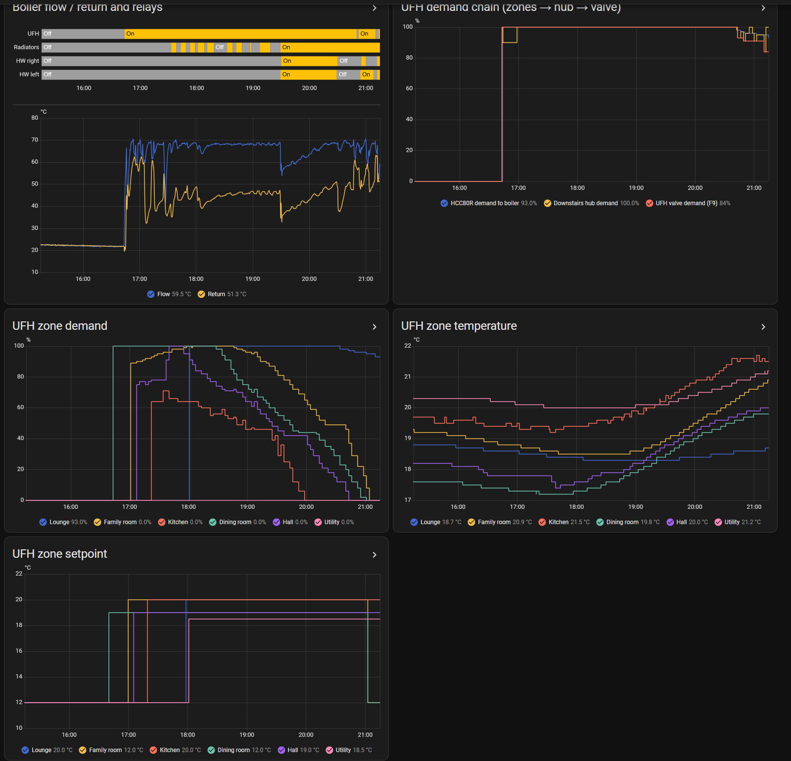

# B9 · UFH and Radiator Behaviour: ALS, Optimum Start and the Lounge Fault

[← Back to README](../README.md)

With trustworthy UFH demand ([B8](B8-ufh-demand-decoding.md)) and the plant-monitoring boiler states, the two hubs' behaviour can be measured rather than guessed.

## Advanced load scaling: Normal → Partial (downstairs hub, 7 Nov 2026)

ALS is set **per hub** and learns **per zone** (heat capacity), adapting over up to a week. Changed on the downstairs (UFH) hub only, with nothing else changed for a week.

| Observation | Normal (before) | Partial (after) |
|---|---|---|
| F9 UFH valve demand at HCC80R ~51% | - | ~16% |
| at ~64-71% | ~30% | ~26-35% |
| at ~75-78% | ~44% | ~52-55% |
| at ~84% | ~70% | ~65% |
| Optimum start lead (Lounge, weekday) | 30 min | 50 min |
| Dining room lead | 10 min | 30 min |

Optimum start (also per hub, learning per zone from heat-up rate, using predicted outside temperature) did **not** reset with the ALS change. Morning shortfalls remain (Dining 17.6-17.9 °C, Family 19.1-19.4 °C in 1-1.5 h windows): candidates are a longer morning period, a longer optimum-start limit (up to 3 h), or a higher setback (a one-zone test is planned, compared on heating degree days and gas use).

## The Lounge fault (from 8 Nov)

Floor stone cold all evening, although:
- the Lounge zone demand was **100%** for hours, HCC80R outputs **1 and 2** at 100% with LEDs on,
- the UFH relay was on continuously, with F9 at 100%, and the boiler firing.

So the controller, the HCC80R's commands and the hot water at the manifold are fine; the fault is **after** the HCC80R, or in its bindings. Two leads:

1. **A direct sensor binding:** during the 3 Nov rebuild, the Lounge T87RF's bind was caught by output 1's **sensor slot** (LED 1 flashing, then solid **red**). A red slot gives that output a second control source. Check: installation mode, step to LED 1's red slot, clear it, re-test.
2. **Heat going elsewhere:** the Family room kept rising after its own demand ended (to 21.1 °C on 9 Nov, 20.7 °C on 8 Nov) while the Lounge was calling. If outputs 1/2 actually open Family loops, the Lounge stays cold and the Family room overshoots. Check: with only the Lounge calling, follow which loops warm at the manifold.

### Evening of 11 Nov: a sharper lead

- The Lounge was at **93-100% demand from 18:00** (HCC80R and F9 at 100%, boiler firing) and rose only **18.0 → 18.7 °C** against 20 °C.
- **Leading hypothesis: the installer's loop labels are swapped between the Lounge and the Family room**, so each zone's outputs drive the other room's loops. That explains the Family room overshooting while the Lounge calls, and the Lounge's slow creep later from the Family room's earlier demand.
- **The Utility room** warmed ~19.3 → 21.2 °C (2.7 K over its 18.5 °C setpoint) with **zero demand all evening**: a second mislabelled loop, heat from the Kitchen, or appliances.
- Kitchen and Family room kept rising after their demand ended (UFH slab lag, partly).

**Test:** one zone at a time (others at minimum, ~20 min each): Lounge, then Family room, then Utility; note which loops' flow pipes warm at the manifold and which rooms they serve. **Fix:** swap the bindings or the actuator plugs, then re-check that the Lounge warms.

Status: open (loop test next).
