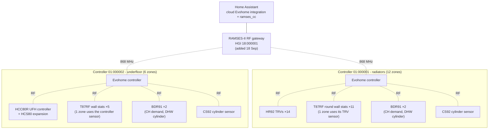

# C1 · Fault Diagnosis Case Study: Evohome "Permanent 5 °C Override" on Two Controllers

**A structured fault investigation on a live two-controller Honeywell Evohome system (18 zones: radiators plus underfloor). Every zone on both controllers locked to a 5 °C "override" that re-applied at each schedule switchpoint, survived power cycles and the removal of every integration, and had no Cancel option. The fault was diagnosed by elimination, cleared by rebuilding zone bindings, and the suspected cause was cleared with packet-log evidence.**

[← Back to README](../README.md)

> **The short version:** the day after a RAMSES-II RF gateway was added, every heating zone on both Evohome controllers locked to 5 °C. The schedules never contained 5 °C, the system wasn't in Away or frost mode, and the zones said "Override" with no way to cancel. Unplugging the gateway, removing every Home Assistant integration and power-cycling didn't clear it. A side-by-side icon comparison pointed the investigation at stored zone state rather than at anything external. Deleting and re-adding every zone and re-binding every TRV, wall stat and the underfloor controller cleared it. A later audit of the gateway's own transmit log showed it **never** sent a 5 °C or permanent-override command, so it was not proven to be the cause, and it went back into service with transmit auditing in place.

---

## Contents

1. [The fault](#1-the-fault)
2. [System under investigation](#2-system-under-investigation)
3. [Impact](#3-impact)
4. [Timeline](#4-timeline)
5. [Investigation: hypotheses and tests](#5-investigation-hypotheses-and-tests)
6. [The decisive observation](#6-the-decisive-observation)
7. [Fix](#7-fix)
8. [Root-cause analysis](#8-root-cause-analysis)
9. [Verification](#9-verification)
10. [Controls put in place](#10-controls-put-in-place)
11. [Lessons learned](#11-lessons-learned)
12. [Skills demonstrated](#12-skills-demonstrated)

---

## 1. The fault

| Symptom | Detail |
|---|---|
| Setpoint | **Every zone on both controllers at 5 °C** |
| Display | Zone tiles said **"Override"**, with a **sun-and-thermometer** icon |
| Cancel | **No "Cancel override" option** on affected zones |
| Schedules | Unchanged and correct, and never containing 5 °C |
| System mode | Normal (not Away, Heating Off or frost) |
| Persistence | Manual changes held only until the **next schedule switchpoint**, then every zone returned to 5 °C |
| Power cycle | Turning a controller off and on sometimes restored the schedule, but only until the next switchpoint |

## 2. System under investigation

Radiator zones have their own HR92 TRV(s), and underfloor zones are driven through the HCC80R. In most zones a T87RF wall stat provides the room temperature. "Local override" (letting the wall stat change the setpoint until the next switchpoint) had been enabled on every zone for years. Full detail: [A1 · System design](A1-system-design.md).

## 3. Impact

- **The house went cold.** A 5 °C target means no zone calls for heat, so the heating simply didn't come on.
- **Daily manual workaround:** every evening each zone had to be overridden by hand. That only lasted until the next switchpoint, when everything dropped back to 5 °C.
- **Both systems affected:** 18 zones across two independent controllers.
- **Duration:** about two weeks, from 19 Sep until both controllers were rebuilt in early October.
- **Risk:** a full controller factory reset (re-pairing every device) was the expected last resort and was avoided.

## 4. Timeline

Full table: [data/timeline.csv](../data/fault-timeline.csv)

| Date | Event |
|---|---|
| 18 Sep | RAMSES-II gateway set up; ramses_cc configured through the **in-development HA MQTT bridge** option |
| 19 Sep 11:12 | Downstairs controller broadcasts zone 00 at **5.00 °C** (`01F4`) while its other zones hold 12.00 °C |
| 19 Sep 17:28 | Every zone on both controllers found at 5 °C. Gateway unplugged at 17:32 |
| 19 Sep 18:10 | Manual settings revert to 5 °C at the next switchpoint |
| 21 Sep | Still faulty 24 h later, with gateway unplugged and ramses_cc disabled |
| 25 Sep | Cloud (TotalComfort) integration examined: no rogue configuration |
| 2 Oct | Cloud integration and ramses_cc **removed entirely**: no change. Icon comparison carried out ([§6](#6-the-decisive-observation)) |
| 3 Oct | One zone deleted, re-added and re-bound as a test: it recovered |
| Early Oct | **Both controllers cleared**: every zone rebuilt; the underfloor zones' actuators re-bound on the HCC80R |
| 9 Oct | Gateway back in service (standalone MQTT mode, Tx off); **packet-log audit** ([§8](#8-root-cause-analysis)) |

## 5. Investigation: hypotheses and tests

Each candidate cause was tested by removing it and observing at the next switchpoint. Detail: [C3](C3-hypotheses-and-tests.md)

| # | Hypothesis | Test | Result | Verdict |
|---|---|---|---|---|
| H1 | System mode (Away, frost, Heating Off) | Checked mode on both controllers | Normal mode | ❌ Ruled out |
| H2 | Schedules corrupted to 5 °C | Inspected schedules | Correct, no 5 °C anywhere | ❌ Ruled out |
| H3 | Gateway **actively** sending commands | Unplugged, then 24 h+ through multiple switchpoints | Fault persisted | ❌ Not an active cause |
| H4 | HA automation or integration sending commands | No automations exist; cloud integration commented out; ramses_cc deleted | Fault persisted | ❌ Ruled out |
| H5 | Cloud service pushing commands | Pattern only at switchpoints, never at random times | Not consistent with cloud commands | ❌ Unlikely |
| H6 | Normal local (wall-stat) override | Compared with a deliberate wall-stat override | Different icon and behaviour ([§6](#6-the-decisive-observation)) | ❌ Different mechanism |
| H7 | **Stored zone state corrupted in the controller/zone bindings** | Delete, re-add and re-bind one zone | That zone recovered | ✅ **Confirmed fix path** |
| H8 | Corruption in individual TRVs or wall stats | Rebuilt zones re-bound to the **same** devices | Recovered without replacing hardware | ❌ Devices not at fault |

## 6. The decisive observation

| | Deliberate wall-stat override | Faulted zones |
|---|---|---|
| Label | Override | Override |
| Icon | **Clock** (temporary, until next switchpoint) | **Sun and thermometer** |
| Cancel button | **Yes** | **No** |
| Setpoint | Whatever was set | Always 5 °C |
| Clears itself | At the next switchpoint | Re-applied at every switchpoint |

Both cases used the word "Override", but they were two different mechanisms. The faulted state wasn't a user override the controller could cancel; it was a state the controller re-asserted at each switchpoint. That moved the focus from "who is sending commands?" to "what has the controller stored for these zones?", and led to the zone-rebuild test.

## 7. Fix

Per zone, on each controller (detail and binding quirks in [C5](C5-fix-procedure.md)):

1. **Delete** the zone on the controller.
2. **Re-add** it with the same name and type.
3. **Re-bind** the TRV(s), then the **T87RF** wall stat as the zone's remote sensor (T87RF binding uses its touch zones, not a button).
4. **Re-enter** the zone's schedule.
5. Wait for the next switchpoint and confirm that it follows the schedule.

For the underfloor controller, the **HCC80R** actuator for each zone also had to be re-bound. The controller reports "success" before the HCC80R has accepted the bind. The real confirmation is the HCC80R zone LED changing from **flashing green to solid amber**.

No factory reset was needed, and no hardware was replaced.

## 8. Root-cause analysis

**Proven:** the fault lived in the controllers' stored zone configuration or bindings, because rebuilding the zones cleared it with the same hardware.

**The obvious suspect was audited, not assumed.** The fault started the day after the gateway was added, so the gateway's own logs were analysed ([C4](C4-packet-log-analysis.md)):

| Check | Finding |
|---|---|
| Everything the gateway (18:000001) transmitted, 18 Sep onwards | Only **RQ** (read requests) and **W 2349** zone-mode writes |
| Any write of 5 °C (`01F4`) | **None** |
| Any permanent override (mode `02`) | **None**. The writes were mode `01`, temporary until the next switchpoint |
| Any write to the downstairs controller | **None**, yet the downstairs controller faulted too |
| First write | 18 Sep 23:48: one zone 21.50 °C temporary |

The gateway didn't command the 5 °C state, and it never wrote to one of the two affected controllers. **Working theory (unproven):** the controllers' stored zone state was disturbed while the system was first being probed through an in-development integration path (the HA MQTT bridge option), possibly through malformed or repeated traffic during a period of poor gateway Wi-Fi, rather than through a 5 °C command. There's been no recurrence since the gateway moved to the standard standalone MQTT mode. An honest verdict: **cause not proven; fix proven; gateway exonerated as a direct sender.**

## 9. Verification

- Both controllers followed their schedules through repeated switchpoints after the rebuild.
- With the gateway back in service (standalone MQTT, Tx off) for about 48 h, there was no recurrence.
- With Tx later enabled, an audit command confirms that only reads and deliberate, targeted temporary setpoints are sent.

## 10. Controls put in place

| Control | Purpose |
|---|---|
| Standard (released) integration mode only on live plant | No in-development code paths on a live heating system |
| Gateway Tx **off** until the system was proven stable, then enabled deliberately | Read-only first, write later |
| Audit command for any non-read packet from the gateway | Every write is visible ([C4](C4-packet-log-analysis.md)) |
| Packet logs retained, with a copy kept from the fault period | Evidence for any future incident |
| Rules: never use HVAC "off", Heating Off or Day Off presets from HA; avoid the schedule-download service (known to stall Tx) | Avoid system-wide writes from HA |
| Watch for the sun-and-thermometer icon or any zone at 5 °C | Early detection |

## 11. Lessons learned

1. **Read the evidence the system gives you.** The same word ("Override") hid two mechanisms; the icon and the missing Cancel separated them.
2. **Eliminate one variable at a time, and test at the event that triggers the fault.** Here that event was the next schedule switchpoint, not the moment of the change.
3. **Don't convict the newest component without evidence.** Timing pointed at the gateway; its transmit log cleared it as a direct cause.
4. **Prefer the smallest effective intervention.** A one-zone test before rebuilding all zones, and zone rebuilds rather than a factory reset.
5. **Know your devices' real acknowledgements.** "Success" on the controller wasn't the same as the HCC80R accepting the bind.
6. **Change control matters on live plant:** released integration modes, read-only first, logged writes.
7. **Be honest about what's proven.** The fix is proven; the root cause isn't, and the write-up says so.

## 12. Skills demonstrated

| Skill | Evidence |
|---|---|
| Structured fault diagnosis | Eight hypotheses, each with a test and a verdict |
| Protocol-level evidence | RAMSES-II packet decoding (2309 setpoints, 2349 zone mode) to audit a suspect |
| HVAC controls knowledge | Zone, sensor and actuator binding; UFH controller; override modes |
| Live-plant risk management | Least-invasive fixes, no factory reset, change controls |
| Commissioning | Re-binding TRVs, wall stats and UFH actuators, with verification at switchpoints |
| Technical writing | Timeline, hypotheses table, RCA with proven vs unproven clearly separated |

