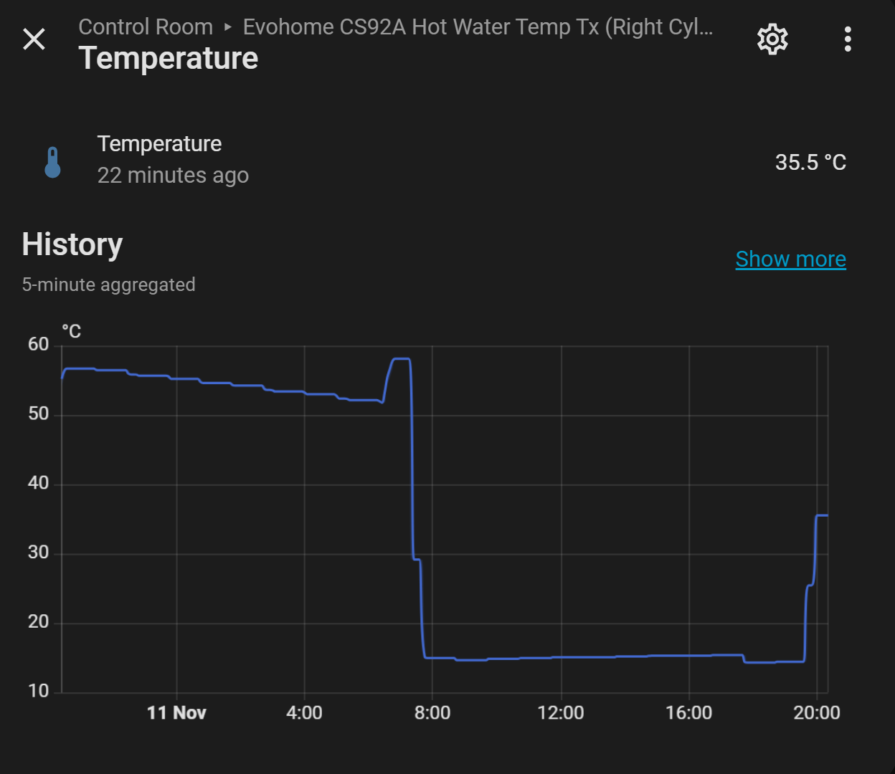
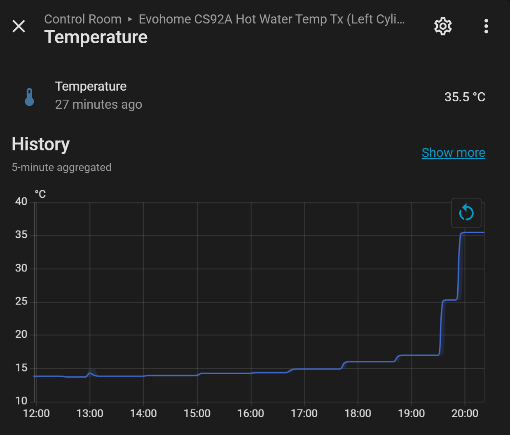

# D1 · Roadmap and Open Items

[← Back to README](../README.md)

## Priority: safety
- [x] **Unvented cylinders' high-limit cut-outs** verified fitted, sensing and in series with each zone valve (29 Oct 2026, [A4](A4-junction-box-survey-and-wiring.md#5-cylinder-wiring-panels)).
- [ ] **Automatic bypass** ([A6](A6-pump-overrun-and-bypass.md)): boiler fault history (L1), pipework search, Benchmark sheet; Gas Safe engineer to fit an ABV or one open radiator of at least 0.6 kW.
- [ ] **TF/MF valve position** in manual override: confirm it doesn't restrict the radiator circuits.
- [ ] Every re-energisation: **TS715Si on permanent ON** (it gates hot water), then BDR91s, heating and hot water checked.

## Junction box tidy-up (planned, box isolated)
- [ ] Hot-water BDR91s re-run in **3095Y 5-core 0.75 mm²** flex via 25×16 mini trunking onto D-Line surface pattresses.
- [ ] **Wago 221** on the four opto-tapped joints; twin ferrules on two-core choc block positions; Danfoss black and grey capped.
- [ ] Sleeving for misused colours; every cable, strip position and the lid labelled with both isolation points.
- [x] Heat-transfer paste on both CS92s (11 Nov 2026).
- [ ] Continuity check of every moved joint against [the terminal map](../data/junction-box-terminal-map.csv) before re-energising.

## RAMSES-II gateway
- [ ] **Move the gateway to a central position (raised priority, 11 Nov).** From the dining room it misses many reports: CS92 temperatures arrived in ~10 K steps every ~25 min during a reheat, and a hub's hot water "off" reached HA ~8 min after the app showed it. Connectivity on a wall adapter: separate supply from Wi-Fi location ([B6](B6-gateway-reliability.md)).

  | | |
  |---|---|
  |  |  |
- [ ] **Cloud integration:** stalled after several HA restarts in a day (all cloud zones blank ~80 min); check recovery, consider `scan_interval: 600`, avoid repeated restarts ([B0](B0-cloud-integration.md)).
- [ ] Update the issue raised with the firmware maintainer with the results (no response yet).
- [ ] Copy the September packet logs to permanent storage; review retention.
- [x] ~~Confirm the upstairs boiler-demand BDR91 (13:000002) is seen in captures.~~ Seen, and its role proven (26 Nov).
- [ ] Optional: alert for any zone at or below 5.5 °C, or the sun-and-thermometer override state.

## OpenTherm and advanced boiler control (planned)

**Decision:** a **DIYLESS OpenTherm shield** on an ESP32 (ESPHome) acts as the boiler's **OpenTherm master**, with **Home Assistant running the boiler logic**. The RAMSES-II data (zone demands, setpoints, temperatures, DHW state) is the input.

| Element | Plan |
|---|---|
| Why not Evohome's OpenTherm bridge | Two controllers, but a boiler has one OpenTherm master |
| Control | HA computes the flow-temperature setpoint and on/off from the RAMSES zone demands; ESPHome sends it over OpenTherm |
| Evohome's role | Continues to run zones, TRVs, UFH and DHW scheduling; its BDR91 states and demands become **inputs** |
| Switched lives | Disconnected from the boiler so only one control path is active (no BDR91 vs OpenTherm conflict) |
| Logic | Weather compensation, load compensation from zone demand, then **advanced PID** (anti-windup, rate limits, minimum on and off times) |
| Safety | Boiler-side work done by a competent person and Gas Safe where required; a documented way back to BDR91 control |
| Portfolio links | #8 PID control, #4 optimum start/stop, #6 alarm and trend strategy |

## Plant room: physical works (to do soon)

| # | Item | Purpose |
|---|---|---|
| P1 | **Replace both DHW expansion vessels and both pressure/expansion relief valves** (plumber) | The tundishes drip when hot water is used, which points to failed vessels or relief valves. It also tells us whether the pressure swings seen on the mains are thermal expansion |
| P2 | **Pressure gauges on both cylinders' cold inlets** (0-150 PSI transducers, 0.5-4.5 V) | Logs each unvented cylinder's working pressure. Pressure rising towards the relief setting while heating is a **second, independent diagnosis** alongside the tundish drip sensors |
| P3 | **Tundish drip sensors** on both tundishes (leak plates) | Detect discharge as it happens, and correlate it with cylinder pressure and DHW heating |
| P4 | **Complete the missing pipe lagging** | Cut primary and DHW losses identified in the heat-loss review |
| P5 | **Diagnose the slow heating-system pressure loss** using the newly installed **boiler pressure gauge** | The boiler's own expansion vessel was recharged and its diaphragm isn't leaking, so the loss is elsewhere. Trend the decay rate, then isolate circuits (radiators, UFH, primaries to the cylinders) one at a time to locate it |

## Plant room: monitoring (to do soon)

| # | Item | Purpose |
|---|---|---|
| M1 | **CT clamp on the boiler switched live / supply** into HA | Distinct current levels reveal boiler states (standby, pump only, firing, DHW), independent of what the controllers say |
| M2 | **Opto-isolated inputs** on the boiler switched live, the timer output and both cylinders' stat-passing points (relay states come from RAMSES-II) | Boiler actually called; hot water enabled; a cylinder relay calling while its stat is satisfied or its cut-out tripped. Inputs for FDD and the OpenTherm logic |
| M3 | **Strap-on NTC probes on both DHW cylinders' hot outlets**, added to a plant-room ESP32 (board and pins to be allocated) | Measures the actual delivered hot-water temperature, independent of Evohome. Compared with the CS92 (lower pocket) reading it shows the **top-of-cylinder overshoot** expected with a lower probe, confirms each reheat, and supports a weekly check that stored water reaches 60 °C |
| M4 | Flow/return temperatures, pressures and leak plates on the plant-room ESP32s | A full picture of the boiler and primary circuits |

These are being built on dedicated ESP32 boards in the control room and understairs plant space. The monitoring build is documented in its own repository: [heating-plant-monitoring-esphome](https://github.com/the-control-cabinet/heating-plant-monitoring-esphome).

## Heating behaviour (November 2026)
- [ ] **Lounge UFH fault** ([B9](B9-ufh-and-radiator-behaviour.md)): HCC80R red sensor slot on outputs 1-2, then the actuator/loop check.
- [ ] Re-measure UFH and radiators after the ALS week: optimum start leads, morning shortfalls, starts per day.
- [ ] Upstairs hub settings review (cycle rate, minimum on time, ALS, optimum start) against the downstairs hub.
- [ ] Interim short-cycling mitigation (one TRV head off), then the bypass; flow temperature 70 → 65 °C as a separate step.
- [x] ~~Cylinder stat check~~: tops reached ~56-58 °C on 11 Nov; the left/right difference is now a reheat-speed question (normal-evening comparison, then zone valve, coil isolation, air).
- [ ] **Legionella:** decide between a 60-61 °C setpoint (Evohome only, robust) and 58 °C plus a weekly HA/RAMSES pasteurising reheat (~65 °C, with a failsafe reset); then implement; check bath/shower mixing valves first ([A3](A3-dhw-cylinders-and-sensor-placement.md#legionella)).
- [ ] **Left/right mapping checks:** which hub, BDR91 and CS92 serves which cylinder (boost one hub; long draw on one side); fix the "… Side of House" names.
- [ ] **UFH loop test** for the Lounge/Family (and Utility) labels ([B9](B9-ufh-and-radiator-behaviour.md)).
- [ ] One-zone setback test (12 °C vs 19 °C), measured on degree days and gas.
- [x] HA notifications: live in the plant monitoring alerts package (low zone temperatures, batteries, zones failing to reach setpoint, hot water); gateway alerts already in place.

## Update (16 Nov 2026)
- [x] ~~Lounge UFH fault~~: loop labels swapped; fixed by rebinding ([B9](B9-ufh-and-radiator-behaviour.md#addendum-12-16-nov-2026)).
- [x] ~~Left/right mapping checks~~: boost test 12 Nov; names fixed.
- [x] ~~Legionella decision~~: 60 °C on both controllers from 16 Nov ([B12](B12-hub-settings-and-change-log.md)); weekly high-temperature heat from HA parked until the write path is proven.
- [x] ~~Upstairs settings review~~: TPI 14 Nov, priority/weather features 16 Nov; results reviewed Sat 21 Nov.
- [x] ~~Gateway move~~: landing, 12 Nov ([B11](B11-rf-health-and-hub-checks.md)); controllers' RF check all 5/5.
- [ ] Schedule writes: upstream fix (#1427), then one verified zone test write ([B10](B10-schedules-in-home-assistant.md)).
- [ ] Family room / Dining room morning shortfall watch; then re-enable sunny rooms for the Family room and Lounge.
- [ ] Batteries: upstairs controller (rechargeable NiMH), Lounge wall stat, HR92s.
- [ ] Gateway: smart plug for remote power cycling; per-device "not heard for 2-3 nights" alert.
- [ ] Landing setpoint trial (20 → 18 °C) after the current changes.

## Update (18 Nov 2026)
- [x] ~~Junction box Stage 1 (functional)~~: Stage 1a done 17 Nov, opto board commissioned ([A4 §8](A4-junction-box-survey-and-wiring.md#8-stage-1a-as-built-17-nov-2026)).
- [ ] **Junction box earth bar (safety):** UFH valve earth to land, hot-water relay earths into separate ports, trace the earth found with the boiler cable.
- [ ] Junction box Stage 1b tidy; Stage 2 (radiator zone valves on W8) after the automatic bypass.
- [x] ~~Downstairs ALS~~: disabled 17 Nov; first morning much better ([B9](B9-ufh-and-radiator-behaviour.md#addendum-17-18-nov-2026-als-off-and-the-hcc80r-bindings)). Upstairs ALS decision at the Sat 21 review.
- [x] ~~HCC80R stray bindings~~: zones 7/8 cleared, zone 6 re-bound.
- [ ] Lounge door-end loop: no power on output 2 (wiring); then a per-output check.
- [x] ~~Per-device "not heard" alert~~: live ([B11 §6](B11-rf-health-and-hub-checks.md#6-per-device-not-heard-monitoring-16-nov)); tighten the threshold after the 72 h review.
- [ ] After the morning watch (~19 Nov): sunny rooms for the Family room and Lounge, cold weather boost, UFH mixing temperature 45 °C trial and pump mode III → CP1 (plant monitoring repo), one at a time.

## Update (19 Nov 2026)
- [x] ~~Is the UFH binding wrong?~~ No. The controller's own curve turns zone demand into relay demand the same way on both controllers and in both relay roles (heating valve and boiler relay), with load scaling disabled ([B8 §8](B8-ufh-demand-decoding.md#8-addendum-19-nov-2026-the-curve-is-evohomes-own-not-the-binding-or-load-scaling)).
- [ ] Trial (Sat 21 decision): Dining room weekday morning 19.0 → 19.5 °C, single change.
- [x] ~~Per-device "not heard" threshold~~: 6 → 3 h (19 Nov), from normal nights peaking ~2 h.
- [x] ~~Off-gap check~~: closed. The boiler relights 86-97 s after a real cut-out (plant monitoring repo).

### OpenTherm design input (from B8 §8)
The OpenTherm/HA control should **not** inherit Evohome's demand curve for the screed floor:
- **UFH relay decided by HA** from the HCC80R zone demands (or room error and floor response), so a zone at ~60 % gets ~60 % valve time rather than ~23 %. A first step can run before OpenTherm: HA drives the UFH valve relay path directly, with Evohome's call as a fallback (same interlock principle as the OpenTherm switch-back).
- **Separate treatment for radiators and screed:** short TPI cycles and the existing curve suit radiators; the slab needs longer on-times and earlier starts.
- **Measure it:** the RAMSES 3150/0008 decode and the ESP32 opto inputs already give before/after evidence for any controller change.

## Update (26 Nov 2026)
- [x] ~~Which relay is the boiler relay?~~ Proven: upstairs radiator BDR91 (13:000002) = boiler relay; downstairs UFH BDR91 (13:000004) = heating zone valve ([B12](B12-hub-settings-and-change-log.md#relay-roles-and-the-binding-plan-26-nov-2026)).
- [ ] **Phase 2** (after the automatic bypass and the TF/MF radiator valve heads are re-powered): rebind 13:000002 on the upstairs controller as a heating zone valve; re-check the plant monitoring's radiator signal (it reads "radiators or left cylinder" until then).
- [ ] **Phase 3** (HA / OpenTherm): HA fires the boiler with its own minimum on time, and decides the UFH relay from zone demand (above); the controllers' cycle rate and minimum on time stop mattering.
- [ ] Decide: Dining weekday morning 19.0 → 19.5 °C (recommended; [B9](B9-ufh-and-radiator-behaviour.md#addendum-23-26-nov-2026-the-dining-morning-plateau-the-play-room-and-48-second-ufh-pulses)).
- [ ] Pump 100 % trial (from 25 Nov), then the flow temperature test (the boiler's CH knob also sets the cylinder reheat flow: cylinders must still reach 60 °C).
- [ ] Towel rail open-load trial: recheck at like return temperatures.
